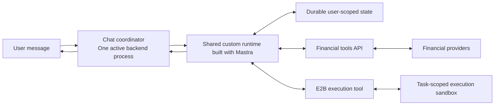
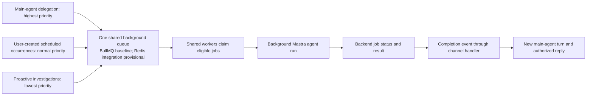

# MyStacks custom runtime architecture

## 1. Direction and scope

**Status: tentative overall design, to be finalized in the architecture design round.** The working design incorporates the component and security decisions recorded in the ADRs: a custom runtime built with **Mastra**, direct normal-chat execution, and queued background work on a separate **GCP Cloud Run worker pool** with durable state outside worker processes. **E2B is the selected generated-code sandbox; one PostgreSQL database holds application-owned and Mastra-owned tables; BullMQ is the initial background queue baseline with provisional Redis integration.** Channel-turn ordering, main-agent-owned replies, native per-channel context compaction, and the memory and background-work boundaries below are agreed Phase 1 direction. Concrete framework mappings, API/chat and database hosting, worker-pool configuration, package versions, model providers, interfaces, and detailed operating policies remain open. No runtime implementation exists in this repository.

Phase 1 provides financial information, analysis, and proactive monitoring through **read-only financial access**. It excludes specific buy, sell, or rebalance recommendations and financial execution. Concise chat reports, memory, informational tasks, and messages remain in scope. The runtime must support flexible work within wealth and assets, useful partial answers from available evidence, user-defined ongoing tasks, daily morning digests, and useful independent initiative.

Chat is the default assistant surface after required phone/SMS signup and channel linking. Successful phone verification opens the persistent website dashboard, where financial connections and channel linking can happen in either order. The dashboard manages financial connections and messaging channels through the same flow for new and returning users, with portfolio previews, Add more, and Continue to chat. Financial connections are optional. iMessage and WhatsApp are the launch channels, separately linked to the same stable MyStacks account. Chat manages its own tasks and shared personal memory; connection removal and channel linking/disconnection belong on the website. Web and chat share the proactive insight delivery channels setting.

User-requested monitoring follows the user's confirmed schedule and timezone. Independent proactivity targets **approximately five bounded agent investigations per eligible account each day**, randomly spaced within **09:00–21:00 in the saved user timezone**. The window limits investigation starts; a result may arrive later. Device timezone is captured once at onboarding; users explicitly change their default in the web app or chat, and task-specific overrides affect only that task. Existing schedules keep their assigned timezone unless edited. Automatic re-detection on later website visits is deferred. Confirmations show time and zone; exact recurrence/daylight-saving mechanics remain open. Checks and delivery are best effort. Precision takes priority over recall; some events may be missed. Hosting and queue choices do not strengthen these limits.

Launch planning assumes **1,000 users**, with a **100,000-user growth target**. Whether these figures mean registered or active users remains undefined. They do not determine concurrent workload or worker count.

[Requirements](requirements.md) owns product behavior. The [ADR catalogue](ADRS/README.md) indexes the accepted decisions and their rationale, including runtime, security, channel scope, memory, storage, identity, calculations, and report presentation. This document owns component responsibilities and execution flows.

The [user stories](user-stories/README.md) describe the complete Phase 1 experience. The [detailed technical designs](design/README.md) develop supporting contracts within this architecture, with proposed choices and unresolved policies kept explicit.

## 2. Components and responsibilities

### 2.1 Canonical terminology

| Term | Meaning |
| --- | --- |
| **MyStacks backend** | Trusted application code that provides orchestration, runtime execution, tools, authorization, and durable state access. These responsibilities need not be separate services. |
| **Existing agentic runtime** | The shared-machine approach represented by `mystacks-be` and `hs-llm-service`, where application orchestration handles conversations and trusted tools execute on shared compute. The approach can support the requirements; the reference implementations do not establish that all required features exist. |
| **Orchestration layer** | Binds incoming work to an authenticated user, routes chat and background jobs, and delivers progress and results to authorized product surfaces. |
| **MyStacks account** | Stable owner of personal memory, financial connections, conversations, and tasks. Its primary verified login phone number is a changeable binding. |
| **Channel binding** | A separately verified relationship between a messaging sender or conversation and a MyStacks account. It does not follow merely from matching phone numbers or email addresses. |
| **Conversation thread** | A channel conversation's stored messages and current context. Its history and native Mastra Observational Memory compaction remain separate from other linked channels. |
| **Channel event stream** | The logical ordered inbox of user messages and internal background-completion events for one linked channel. It does not imply a separate queue, process, or VM for that channel. |
| **Custom runtime** | MyStacks-owned application built with Mastra's regular `Agent` and native context, tool, skill, and memory facilities. A runtime run is an invocation of this software, not a permanent process assigned to a user. |
| **Main agent** | The conversational agent that processes channel events, uses tools, delegates background work, and owns all agent-authored user replies. |
| **Foreground turn** | One main-agent processing cycle for pending channel events and relevant context. It can contain several model/tool rounds and end with a reply, delegation acknowledgement, or no unnecessary message. Only one runs at a time per channel. |
| **Model round** | One model invocation within a foreground turn or background run. It may request several tools whose results feed a later round. |
| **Background subagent** | A separately queued agent run delegated by the main agent that returns internal findings, data, evidence, or artifact references. It cannot spawn subagents or send user messages. Scheduler-started background agent runs use the same restricted capabilities but have separate admission rules. |
| **Completion event** | An internal event referencing a saved background result. It starts or awaits a new main-agent turn with the original request and current permitted channel context. |
| **RequestContext** | Mastra's per-request context. MyStacks creates a fresh instance for each run and binds authorized account, channel, resource, and thread identifiers from trusted backend context. It is distinct from durable memory. |
| **Worker** | A long-lived MyStacks application process that claims queued jobs and runs work. It can handle concurrent runs with separate user contexts; it is not a cloud resource created for each job. |
| **Task** | A durable standing request with intent, current status, user, originating channel, and trigger. Its channel fixes delivery and chat control scope. It remains distinct from the attempts that execute it. |
| **Schedule** | A durable definition of when an informational task becomes eligible to run. A user-created schedule admits each eligible occurrence as an independent background agent run. |
| **Job** | A queued unit of work that a worker claims for execution. A schedule can produce many jobs over time. |
| **Run attempt** | One execution of queued work, with its own progress and outcome. Retrying work does not create a new standing task. |
| **Skill** | Instructions that guide the runtime's work. A skill does not execute code by itself. |
| **Tool** | An executable capability exposed to the runtime, such as an authorized financial read or isolated code execution. |
| **Financial tools API** | The backend boundary that authorizes financial reads, uses provider or connected-account credentials where required, and returns evidence to the runtime. |
| **Execution sandbox** | An isolated E2B environment for generated code and selected input belonging to one user's task or analysis session. It does not own the agent loop or schedules. |

### 2.2 Logical ownership

| Owner | Responsibility |
| --- | --- |
| Orchestration layer | Authenticate channel and website requests; resolve and authorize the stable account, channel, and conversation thread; deduplicate and order channel events; supply trusted run context; start direct main-agent turns or queued background work; recheck current permissions, task status, and channel before delivery. |
| Custom runtime | Use Mastra to execute main-agent and background runs, load relevant context and memory, and compose authorized skills and tools; apply MyStacks financial logic and output limits; check results. Main-agent turns own replies and supported changes to memory, preferences, and tasks. |
| Task boundary | Persist standing task intent, status, user, originating channel, and trigger separately from attempts; enforce current-channel task access and accepted lifecycle policy. |
| Scheduling and queue layer | Under the initial BullMQ baseline with provisional Redis integration, own timing, queued dispatch, claims, and configured job retries from backend-registered schedules. It triggers runs rather than reasoning about a user's portfolio. |
| Worker | Execute claimed background agent runs with bound user context; persist actual job status and results in the backend database and emit completion events. |
| Financial tools API | Verify user, account, and object access; use backend-held provider and connected-account credentials where required, which no other runtime tool receives; return the shared financial evidence contract to authorized product consumers. |
| E2B execution tool | Accept generated code and selected input, with financial data already returned by the financial tools API; enforce sandbox network and resource policy; return outputs, errors, and artifacts; persist required artifacts and terminate the disposable sandbox when analysis ends. |
| Hosting providers | Supply the selected compute, isolation, storage, and network capabilities. MyStacks retains responsibility for application behavior and authorization. |

The orchestration layer and custom runtime remain logically distinct even when they share a deployment. Routing work to the correct user does not require a separate LLM. Shared compute may be a fleet of processes or machines; it does not imply one large server.

The service deploys common runtime code, curated tools, and skills. User preferences, task instructions, memory, and conversation context vary through durable user-scoped state. The runtime composes these capabilities for financial work without requiring a new hard-coded intent for each analysis. Data coverage and method correctness still limit which analyses it can complete. The [agent capabilities ADR](ADRS/0006-composable-agent-capabilities.md) defines this composition and keeps a credential-injecting API proxy as a future option for demonstrated tool gaps.

### 2.3 Mastra framework boundary

The runtime uses Mastra's **regular `Agent`**, native tool registration, skills, context management, and memory facilities instead of building equivalent engines. Mastra provides agent execution and integrates AI SDK provider interfaces and adapters for model access. MyStacks owns user authentication, user/account/object authorization, financial domain logic, task behavior, notification and delivery controls, data accuracy, and retention. [Mastra agents](https://mastra.ai/docs/agents/overview), [Model providers](https://mastra.ai/models)

A common `Agent` definition can serve many users. Each run receives a **fresh trusted `RequestContext`** and authorized resource and thread bindings; the model cannot choose or replace the user binding. MyStacks must configure and validate those bindings on every entry path. Identifiers and framework storage scopes alone do not confer user permissions. Private run context must not be stored in shared mutable fields on agent definitions. [Request context](https://mastra.ai/docs/server/request-context)

Mastra loads curated skill folders containing `SKILL.md` and any references or scripts. Backend tool modules are explicitly registered trusted code; their availability may vary by authorized user context. Loading a skill does not grant tool rights or execute its scripts or backend code. MyStacks may use native tool hooks and processors for policy and observability, while protected-action authorization remains inside tool handlers or the financial tools API on every path. [Skills](https://mastra.ai/docs/skills), [Filesystem skills](https://mastra.ai/docs/sandbox/skills)

The channel handler, foreground-turn ordering, background admission, and completion routing are **MyStacks application contracts**. They do not establish an exact Mastra API or require workflow checkpoints. Background subagents receive useful authorized read, research, and code-execution tools and shared personal-memory read access. Backend capability checks prevent them from changing settings, connections, memory, or saved user tasks, sending messages, or spawning children.

Existing SDKs and native adapters should be used directly when they meet the contract. The E2B execution tool is a necessary application boundary for authorized user data, outbound access, sandbox lifecycle, and artifact persistence. It may use `@mastra/e2b` or the direct E2B SDK; that adapter choice remains an implementation detail. A static shared workspace or live sandbox must not expose private files or execution state across users. [Mastra E2B integration](https://mastra.ai/integrations/sandboxes/e2b)

### 2.4 Tentative account, channel, and context mapping

The orchestrator selects and authorizes the account, channel, and conversation; Mastra loads and manages the selected context through its configured memory facilities. Mastra does not need channel-provider identity rules to distinguish iMessage from WhatsApp. The tentative mapping uses the stable account as the memory resource and the verified channel conversation as its thread. Framework identifiers do not replace authorization.

The [onboarding design](design/onboarding.md) owns signup, QR and button-based linking messages, channel bindings, and website connection controls. The [runtime design](design/runtime.md) owns separate channel histories and compaction, shared account personal memory, and the handoff to Mastra. A channel's model context combines recent raw messages, its compact notes, and the account-shared structured profile. Useful user facts can carry across channels through that profile; transcripts, task logs, and results remain in their originating channel. Phase 1 provides neither vector retrieval nor cross-channel history retrieval. Current financial facts and task state continue to come from protected backend operations.

Background work uses independent agent runs with its own working context while the main chat remains available. Their internal results return through a new main-agent turn; the resulting reply joins normal channel history. Chat lists and manages only jobs and tasks originating in its channel. Task tools derive channel scope from trusted backend context and expose no destination selector or cross-channel transfer. Ordinary chat does not steer an active foreground or background run. These scopes share worker infrastructure and require no permanent runtime or queue per channel.

The [task design](design/tasks.md) owns fixed task delivery and separate proactive routing. Disconnecting a task’s channel pauses the task; relinking leaves it paused until explicit resume from that channel. Users select one, both, or no linked proactive insight delivery channels through web or chat, with every newly linked channel selected by default. Disconnecting a selected channel removes that destination without enabling an unselected channel. The website shows connection previews; portfolio answers in chat are user-requested.

Human support is an accepted channel capability during published working hours. The [runtime design](design/runtime.md) owns the pending handoff integration: a real staff member replies in the originating channel with only necessary authorized context, and assistant/human reply ownership must avoid conflicts. Staffing, hours, response expectations, and the proposed Slack staff tool remain in [TODO](TODO.md#2-human-support).

Apple-specific controls remain TBD and must meet the minimum applicable requirements without guiding general product UX. [TODO](TODO.md#1-apple-messaging) owns confirmation of the Apple service/provider and permitted notification scope before committing to Apple proactive delivery.

The account/resource and channel/thread mappings remain **tentative until the overall architecture review**. Database schemas, concrete framework configuration, and channel-provider adapters remain open within the accepted storage, memory, channel-turn, and work boundaries.

### 2.5 Financial provider integration

The [provider decision](ADRS/0018-managed-financial-data-providers.md) selects **SnapTrade** for target Binance, Coinbase, Interactive Brokers (IBKR), moomoo, and Robinhood accounts; **Zerion** for supported EVM and Solana wallets; and the direct **Hyperliquid API** at low priority. The audience has mixed, global accounts, while actual regions, account types, products, and history remain provider-driven. DeBank is an optional future complement for demonstrated EVM gaps. Bybit, Upbit, and prediction-market connectors are deferred without restricting general finance questions or research.

The [onboarding design](design/onboarding.md) owns provider setup and verified connection binding; the [portfolio design](design/portfolio.md) owns read adapters and evidence. Hyperliquid setup reuses an eligible verified EVM wallet or verifies new control through a readable challenge, then binds the actual user account address. Its documented public information reads need no user private key, OAuth token, or trading key, while MyStacks still authorizes the user's active verified connection. Chat, schedules, and proactive work use the same trusted connector. Initial reads use on-demand REST through **Webshare** as backend outbound transport; WebSockets require a demonstrated need. Proxy pool, type, count, region, rotation, routing, and limiting remain open. Hyperliquid limits apply per exit IP, including workers sharing an exit; Webshare does not establish a capacity or freshness guarantee. Proxy authentication stays in the trusted backend.

Provider selection does not establish complete current coverage. SnapTrade's delayed IBKR feed and moomoo regional limits remain unresolved for the intended audience. Polling guidance, permitted proactive use, retained-evidence terms, and Zerion source-time semantics also require validation under the [provider decision](ADRS/0018-managed-financial-data-providers.md) and [integration TODO](TODO.md#3-financial-provider-integration). Provider account modes, shared collateral, and overlapping Zerion/Hyperliquid evidence must not cause double counting. History remains provider-bounded without a MyStacks indexer.

## 3. Execution flows

### 3.1 Conversation and continued work

The [architecture diagram](architecture.html) visualizes this flow and the trusted backend boundary. Open the HTML file in a browser to view it.

The orchestration layer verifies, deduplicates, and stores an inbound message, promptly acknowledges transport receipt, and executes normal chat **directly in the backend**. The initial design accepts that process or deployment interruption can leave an acknowledged turn without a reply; saved messages alone do not resume inference. Chat-turn execution remains callable independently of the transport so dispatch can change when a concrete requirement justifies it.

**One active ordinary API/backend process coordinates chat for all users in Phase 1.** Different channels can execute concurrently, while each linked channel has one logical ordered event stream and **one foreground main-agent turn at a time**. User messages and background completions enter the same channel handler; ordering can stay in-process. A turn consumes pending user messages and/or completion events with relevant channel context and may perform several model/tool rounds. Events arriving during an active turn wait for a later turn and may be handled together. Distributed channel ownership is deferred until observed capacity or availability needs justify multiple active coordinators.

For every run, the backend supplies fresh trusted `RequestContext` and authorized resource and thread bindings. Mastra loads the shared profile and the channel context described in section 4.2. Cross-channel transcript or task retrieval is outside the Phase 1 tool surface. Quick work runs inline. For substantial work, the main agent explicitly starts background subagents, receives accepted job IDs, acknowledges the work as appropriate, and ends its turn so new questions and status requests can proceed.

The configurable initial limit is **five outstanding queued or running main-agent-delegated background subagents per chat**. Terminal jobs and scheduler-started runs do not count; the main agent reports capacity rather than accepting a sixth delegation. Only main-agent turns may spawn subagents, and backend capability checks enforce that boundary. Further delegation by a main-agent continuation counts against the same limit. Actual jobs retain statuses, results, and original-request references; the main agent uses job-status tools for claims about running work and decides from context whether the user's request is answered.

When a background run completes, its worker saves the result in PostgreSQL before completing the BullMQ job. **The coordinator subscribes to native BullMQ `QueueEvents` completion notifications.** Its listener resolves trusted stored bindings and queues completion in the same channel handler used by inbound chat. User-requested work retains its originating account, channel, original-request, and job references. Proactive completion serves the selected eligible destinations from one saved investigation under the task delivery policy. An idle destination channel starts a **new main-agent turn**; a busy channel retains the event for a later turn. Fresh input includes the original request, a compact completion summary and saved result references, and current permitted channel context. The main agent retrieves further result details when useful and can use financial tools or E2B, combine children, delegate more top-level work, reply, or end quietly while another child continues. It owns every agent-authored user reply; completion is internal evidence rather than a new instruction or permission.

PostgreSQL is authoritative for job state and results; the notification signals that work is ready. BullMQ's [event stream](https://docs.bullmq.io/guide/events/) has bounded retention. Saved, unhandled results must remain recoverable after missed events or coordinator restart, while the exact recovery mechanism, event cursor and retention settings, pending-event representation, and duplicate-delivery handling remain open. Notification or delivery failure reuses the saved result without rerunning successful analysis. Native event notification does not establish exactly-once main-agent turns or external replies.

Required messages, job state, and results persist outside the worker. Cancellation acceptance remains distinct from execution having stopped, with exact interruption mechanics open. The [channel-turn decision](ADRS/0009-channel-turns-and-background-subagents.md) owns the rationale; the [runtime design](design/runtime.md) owns detailed mechanics and examples.

All responses and reports use concise, precise text that is readable in chat, including scheduled results and proactive insights. The runtime leads with the main finding, key numbers, and necessary explanation or evidence; follow-ups provide deeper detail. Substantial source research and code execution remain available behind that output. Image replies are low priority; extensive deep-research reports and polished website report artifacts are deferred. The [runtime design](design/runtime.md) owns response composition within this scope.

### 3.2 Scheduled and proactive work

All three background job classes share one execution queue across accounts and a common worker pool. The backend assigns priorities explicitly; normal chat executes directly outside this queue. Priority orders waiting work without interrupting active runs or reserving slots, so even high-priority work can wait for capacity. Trusted run context, permissions, admission, and retries remain specific to each job. The [scheduling ADR](ADRS/0004-durable-scheduling-and-queued-execution.md) owns this shared-capacity trade-off; the [task design](design/tasks.md#22-backend-definitions-and-queue-execution) defines its execution contract.

The **backend database owns saved task definitions and actual background run records, statuses, and results**. Task intent, current status, user, originating channel, and trigger persist between runs. The channel fixes task delivery and chat access. Run attempts retain their own instructions, progress, and outcomes without replacing the standing task; edits affect future runs. **No LLM needs to keep thinking between runs.** Backend code registers recurring schedules; provisional BullMQ Job Schedulers produce eligible jobs from repeat settings and warm workers claim them. Redis stores queue and schedule data; it does not start a stopped worker service. MyStacks uses native scheduling rather than building another scheduler engine. Current BullMQ does not require a separate legacy `QueueScheduler`. [Job Schedulers](https://docs.bullmq.io/guide/job-schedulers/), [QueueScheduler](https://docs.bullmq.io/guide/queuescheduler)

BullMQ owns timing, dispatch, claims, and configured job-level retries; Mastra performs agent execution inside a claimed job. Mastra scheduling or background retry must not independently manage the same work. Application state remains authoritative for saved task intent and run outcomes; concrete schedule mappings and recovery integration remain open within the whole-job policy below.

Backend scheduling tools enforce a configurable **minimum one-hour interval** and **five enabled user-created recurring tasks per chat**. Paused tasks do not consume this saved-schedule quota; enabling or resuming must respect it. For a shorter request, explain the limit and offer hourly without silently changing the schedule. Normal chat and explicitly requested one-off work keep their own execution rules.

Each eligible user-created scheduled occurrence admits **one independent background agent run**, outside the main-agent delegation quota. A previous occurrence still being queued or running does not delay or suppress the next one; both may run in parallel. Current task, channel, and financial-authority checks still apply. Admission is distinct from actual worker start, which depends on capacity. BullMQ can produce recurring jobs less frequently when earlier work has not started; its native schedule mapping requires integration verification. The architecture does not promise exact-time execution, exactly-once delivery, or outage catch-up. [Job production behavior](https://docs.bullmq.io/guide/job-schedulers/)

**User-requested background work has at most two whole-job execution attempts**, per one-off job or scheduled occurrence. If a worker interrupts unfinished work, restart the job from the beginning only while it remains active and authorized and has an attempt left. The existing single retry for a known temporary scheduled-execution failure uses this same allowance; interruption does not add attempts. The main agent receives terminal failure for a concise explanation, while recurrence stays enabled and repeated identical failure notices remain suppressed. Temporary-failure classification, retry delay, and non-interruption one-off failure handling remain open within this ceiling. Tool or SDK retries have a distinct scope.

Recovery operates at the job boundary: it does not resume intermediate reasoning, model calls, or tool steps. Reuse completed saved results; delivery failure must not rerun successful research or calculation. Cancelled or no-longer-authorized work must not restart. The [scheduling decision](ADRS/0004-durable-scheduling-and-queued-execution.md#27-whole-job-recovery-and-shared-attempt-allowance) owns this trade-off; transport retry and uncertain-send policies remain separate.

Scheduled agent runs can use predefined reads and calculations as tools. **Every eligible proactive check starts a bounded agent investigation** without a cheaper data-change prefilter or rule-trigger prerequisite. Defined investigation scopes guide this work; they do not restrict user-created finance jobs. Resource limits for checks, agent runs, and sandbox execution remain open. Data collection, risk calculations, agent analysis, and message delivery remain distinct responsibilities.

Proactive investigations require at least one selected, verified, currently eligible destination, both when scheduling eligible accounts and when queued work starts. Each account investigation can produce an insight for all selected eligible channels; selecting more channels does not multiply investigations. The configurable product default targets approximately five investigations per eligible account per day at randomized times within 09:00–21:00 in its saved timezone. Only one proactive investigation runs per account; overlapping occurrences are skipped, and missed checks do not accumulate a catch-up backlog. The window limits actual investigation starts, so a run starting at 20:58 may produce a reply at 21:03. Exact native scheduling integration and numeric investigation budgets remain open.

Before delivering task results, the orchestration layer rechecks current permissions, task status, and channel binding. Queued data and permissions captured at run start do not establish delivery authority. A future-only task edit preserves active-run instructions; pause or channel disconnection holds delivery that has not started. Resume schedules the next occurrence without a backlog; cancellation ends recurrence and requests cancellation of all queued and running occurrences of that task. Exact interruption, recovery, and duplicate-handling mechanisms remain open.

Users manage their current channel’s ongoing tasks in chat; the assistant immediately applies clear supported requests to create, change, pause, resume, or cancel tasks within the applicable limits and gives a concise confirmation. Material ambiguity requires clarification. Web and chat update the same proactive insight delivery channels selection. No channels selected stops future investigations and suppresses unsent proactive findings; removing one destination suppresses unsent delivery there. User-requested schedules retain their own controls. Task pause, source disconnection, and worker shutdown are separate actions.

For proactive insights, portfolio evidence, shared personal memory, and account-level finding and notification history inform relevance. That history stays separate from personal memory and distinguishes saved candidates from what was actually sent, when, and with what supporting evidence, including as proactive insight delivery channels change. The main agent judges semantic usefulness and newness; backend policy controls eligibility, recognized duplicate attempts, and current delivery authority. Send only meaningfully new, useful findings supported by strong evidence; otherwise remain quiet. High precision is prioritized while accepting lower recall without a numeric guarantee. Explicitly requested updates remain governed by task intent, including quiet-day summaries.

Before each proactive send, recheck that destination’s selection, verified binding, current eligibility, cancellation, and authority. Record outcomes per channel so delivery to one selected destination neither suppresses intended delivery to another nor hides a failure. Proactive investigation failure or worker interruption is recorded internally and waits for the next scheduled check, without whole-investigation automatic retry or a routine user failure message. Transport delivery failures must not rerun the investigation; their retry policy remains open. The [task design](design/tasks.md) owns detailed scheduling, completion, eligibility, and failure policies.

When a financial source is explicitly disconnected, a task continues only if remaining authorized evidence still fulfills its request. Otherwise pause it and explain why once in its originating channel. Restoring that source does not resume the task automatically; the user resumes it from that channel at the next scheduled occurrence without a backlog. Temporary provider outages remain failure-recovery cases. The task design owns the tentative mechanism for applying these rules to affected work.

### 3.3 Generated-code analysis

When an analysis needs generated code, the runtime calls the **E2B execution tool**, a trusted backend adapter:

1. The runtime prepares code and selects the input needed for one user's task.
2. The adapter creates or reuses an isolated sandbox bound to that user's task or analysis session and supplies the selected input.
3. E2B executes the code and returns outputs, errors, and artifacts through the adapter.
4. The runtime checks the result, may revise and rerun the code, and then uses supported findings in its answer.
5. MyStacks persists required reports, files, and results outside the disposable sandbox.
6. The adapter terminates the disposable sandbox when the analysis ends, after required artifacts have been persisted.

A live sandbox must not be reused across users. Reuse within one user's analysis session is permitted. **Outbound internet is disabled by default for financial analysis**; trusted backend tools supply required financial and research data. Any task-specific network exception must be explicit in backend policy. Credentials must not enter the sandbox through mounts, environment variables, files, code, or results.

Sandbox pause is not a deletion action. Session limits, interruption cleanup, permitted pause/resume use, and provider retention and deletion behavior remain open within the persist-then-terminate default. E2B supplies isolated code execution and environment management; the Mastra agent loop stays in the shared backend, which also retains scheduling responsibilities. [E2B documentation](https://docs.e2b.dev/), [Sandbox lifecycle](https://docs.e2b.dev/sandbox)

## 4. Durable state and continuity

### 4.1 State ownership

| State | Logical owner |
| --- | --- |
| Identity, connected-account bindings, and financial credentials | MyStacks backend account and authorization boundary. |
| Portfolio observations and evidence used by the connection preview, chat, reports, and digests | MyStacks backend financial data boundary, separate from personalization memory. |
| Conversation history and compact notes | Mastra-owned PostgreSQL tables using native memory and Observational Memory facilities, scoped to the account and originating channel. |
| Personal memory and personal preferences | Account-shared native Mastra structured working memory in Mastra-owned PostgreSQL tables, with a few stable categories and flexible free-text content. Main-agent turns control profile writes under backend authority. |
| Standing task intent, current status, user, originating channel, and trigger | Backend database through the task boundary, with fixed channel delivery. |
| Background job status, original-request references, progress, results, and pending completions | Backend database through the execution boundary, scoped to the authorized account and channel. |
| Registered schedule timing, queued dispatch, and claims | Scheduling and queue boundary under the BullMQ baseline with provisional Redis integration, derived from authorized backend task definitions. |
| Required working files, chat results, and enabled generated outputs | Durable storage scoped to the account and originating job/channel, accessible through authorized product interfaces. Image replies are low priority; polished website report artifacts are deferred. |
| Notification preferences and delivery records | MyStacks backend delivery boundary. |
| Proactive finding and notification history | Account-level backend evidence and delivery records, separate from personal memory; retain actual sent findings and their supporting evidence as proactive insight delivery channels change. |

**One PostgreSQL database** holds separate application-owned and Mastra-owned tables; it is not a database per user. MyStacks backend authorization governs access to both. Application-owned tables hold task intent, run outcomes, account state, and delivery records; Mastra-owned tables hold its messages and memory state through the native PostgreSQL adapter. Hosting service, concrete schemas, package versions, retention, file storage, and synchronization interfaces remain open. The [storage decision](ADRS/0013-shared-postgresql-storage.md) owns this choice and its trade-offs.

The initial BullMQ baseline uses Redis provisionally for timing, queued dispatch, and claims. Its mapping and update/recovery contract must preserve the PostgreSQL application records' authority for task intent and run outcomes rather than letting both stores make independent scheduling decisions.

The financial tools API returns a consistent evidence contract for portfolio surfaces and analysis: **source, source-data time or unknown freshness, retrieval time, coverage gaps, and native values and units**. Conversions and aggregation must retain the evidence needed to interpret the result. Missing data remains explicit; it must not become a zero balance or absence of risk. Exact schemas, collection ownership, and reuse windows remain open.

The [current-evidence decision](ADRS/0019-current-portfolio-evidence.md) requires fresh or near-fresh relevant account evidence for current portfolio analysis and account-specific proactive conclusions. Request the latest relevant provider data at analysis time, allowing brief appropriate reuse. Account-state freshness and market-price freshness are separate; fresh prices cannot make old holdings current, and retrieval time cannot substitute for source-data time. Delayed evidence can support bounded historical or reporting claims. If timely evidence is unavailable, avoid proactive current-exposure conclusions that depend on it; requested answers remain best effort with concise material limitations and other supported answers remain available. Exact maximum ages and service levels stay open. Approximately five daily proactive checks remain periodic detection, not continuous monitoring.

**Accepted data scope; tentative calculation mechanisms:** Phase 1 aggregates current provider data without a MyStacks indexer. EVM and Solana wallet sources require verified wallet control through the onboarding boundary. Reuse suitable provider-calculated values; common calculation code and definitions serve website previews, chat, and monitoring, while E2B handles flexible generated-code analysis. Display values default to USD and preserve native quantities. Distinguish balance changes from investment returns using supported cash-flow evidence. Fetch only needed data and report supported results; exact formulas and historical capabilities depend on provider coverage. Historical P&L and reconstruction requiring MyStacks-owned history collection or indexing infrastructure are deferred at low priority. Provider-supplied history and metrics remain usable where supported; required durable evidence and outcomes are retained.

### 4.2 Memory policy and user control

MyStacks uses **native Mastra Observational Memory** for token-budgeted compaction within each channel. Model context combines recent raw messages, compact notes from that channel, and the account-shared structured profile. Compaction changes prompt context without deleting stored raw history. Exact thresholds, compaction models, and configuration remain open; vendor defaults of roughly 30,000 raw message tokens before activation and 6,000 raw message tokens retained afterward are illustrative, not selected limits. The [context compaction decision](ADRS/0010-native-channel-context-compaction.md) owns this choice. [Observational Memory](https://mastra.ai/docs/memory/observational-memory)

Account-shared personal memory uses **native Mastra structured working memory**, with a few stable categories and flexible free-text content. Main-agent turns update the profile through the native update tool under backend-controlled authority; research and background agents have read access only. Observational Memory maintains channel notes and does not automatically update the shared profile. Exact category keys, schema, and profile size and selection budgets remain open. The [shared-memory decision](ADRS/0008-channel-scoped-work-and-shared-memory.md) owns the scope, and the [runtime design](design/runtime.md) owns representation details. [Working memory](https://mastra.ai/docs/memory/working-memory)

The assistant **automatically remembers useful personal context**. Clear new user statements update older personal facts; unclear conflicts prompt clarification only when material to the answer. Assistant interpretations remain distinguishable from user-confirmed facts. The profile holds useful personal context rather than copies of transcripts, task records, or results. Live holdings and account permissions come from backend evidence; remembered information cannot override them.

Native partial profile updates preserve distinct fields. For the same field, the **last successful save wins**, including an older, slower turn overwriting a correction or deletion. MyStacks adds no application locking, write ordering, or tombstones; PostgreSQL's internal atomic-merge row locking remains part of the native adapter. A fact within a free-text field still requires editing that field's text. The [profile update decision](ADRS/0012-last-save-wins-profile-updates.md) owns this accepted trade-off.

Users can inspect and correct the profile in chat. **Forget** removes a detail through the same profile update tool; **forgetall** clears the profile. Both leave stored histories and compact notes unchanged. Those retained records can still influence answers or cause a fact to be learned again, so forgetting is best effort. It does not delete conversation, financial, or provider records. The [profile forgetting decision](ADRS/0011-profile-only-forgetting.md) owns this boundary and its trade-offs.

### 4.3 Process and sandbox lifecycle

Authoritative conversation, memory, task, and file state lives outside worker processes. A worker may keep temporary context during a run, and an execution sandbox may keep temporary analysis files, but neither replaces durable user-scoped state.

Workers can restart or be replaced without assigning a permanent machine to each user. Normal chat accepts the interrupted-reply limit in section 3.1. Requested background work restarts from the beginning within its shared two-attempt allowance; proactive investigations wait for the next check, and completed results are reused. BullMQ attempt accounting and stalled-job handling must enforce those policies. Application health, state compatibility, backup/restore, and retention remain open. Account deletion is deferred; export remains proposed.

Main-agent turns in linked channels may update the same account's profile concurrently under the last-successful-save rule in section 4.2. Background subagents only read shared personal memory. Task updates remain governed by the task boundary; a worker or sandbox boundary alone does not enforce their contracts.

## 5. Authorization and isolation

### 5.1 Trusted financial access

`check_binance_balance` calling `GET /agentic/binance/balance` is an **illustrative interface**, not an implemented or fixed API contract:

1. The runtime invokes the tool with trusted execution context bound to the authenticated user.
2. The backend authorizes the user, account, and requested object for that protected action. Model-supplied identifiers do not establish authority.
3. The backend adapter resolves the authorized connection, retrieves the provider credentials required for that read, and calls the provider.
4. The tool returns authorized data through the shared financial evidence contract.
5. The runtime answers from that evidence and identifies partial or uncertain conclusions.

The same checks apply to chat, scheduled jobs, and independent analysis. Runtime authentication, token lifetime, revocation, and interfaces remain open.

**Exchange keys, provider and proxy credentials, refresh tokens, organization database credentials, and E2B management keys remain in trusted backend code and tool adapters.** They must stay out of model prompts, `RequestContext`, durable job or workflow inputs, traces, generated code, tool results, sandbox mounts, sandbox environment variables, sandbox files, and sandbox outputs. Trusted backend runtime code may use the SDK credentials needed to operate its tools; its model and generated code do not inherit that authority.

**API and background-worker processes are trusted backend code.** Both use shared financial adapters to resolve and decrypt required credentials after trusted user, connection, and requested-object authorization. Models and E2B receive authorized data, never the secrets. This accepts that a compromised backend process can expose credentials within its service permissions. A separate financial access service is deferred until a concrete need justifies another service and authorization boundary.

**Application-wide keys use GCP Secret Manager; per-user provider credentials are encrypted in PostgreSQL using GCP KMS.** Application keys include the relevant SnapTrade, Zerion, and Webshare secrets. The [credential decision](ADRS/0002-backend-owned-financial-credentials.md) owns this storage split and its trade-off. Exact provider fields, record schemas, IAM, key granularity, rotation, and the encryption mechanism, including direct versus envelope encryption, remain open. The selected provider determines required permissions, expiry, renewal, and reconnection behavior; illustrative access-token and refresh-token fields are not a universal schema. SnapTrade's customer integration remains open. The [provider-integration TODO](TODO.md) tracks the remaining choices.

### 5.2 Generated-code boundary

Shared workers execute trusted application code and predefined tools. They must not directly execute generated shell, Python, `eval`, or untrusted plugins. Trusted predefined calculation tools can run in the normal backend process; generated code uses the E2B execution boundary.

The architecture does not require an always-on VM or separate kernel for each user. E2B's isolated Linux VM for an execution session is compatible with shared runtime compute. Isolation must be assessed against the selected provider configuration; separate directories in a shared process are not an isolation boundary for generated code. [E2B sandbox model](https://docs.e2b.dev/sandbox)

The adapter must limit selected data and execution resources to the task's needs and enforce the outbound-internet-off default for financial analysis. Exact enforcement, network-exception policy, resource limits, and deadlines remain open. Selected financial data remains sensitive after credentials are removed. Sandbox isolation does not replace backend authorization or prevent allowed code from reading data supplied to it.

### 5.3 Provider trust

Model providers receive the context MyStacks sends. E2B receives selected code and analysis data. Shared hosting and storage providers process the application state they host. Provider security evidence, data terms, processing regions, operator access, network controls, retention, deletion, and export must be evaluated for the chosen configuration before admitting customer financial data.

Choosing E2B as the execution target does not settle those checks. Encryption at rest or a marketing security claim does not establish that a provider cannot access plaintext during processing.

## 6. Operations and capacity

### 6.1 Shared workers and hosting

**Background execution uses a GCP Cloud Run worker pool**, deployed separately from the API/chat service from the same backend codebase. Start with one or two running worker instances and adjust the count manually as capacity requires. One active API/backend coordinator handles foreground turns across channels; pool instances independently consume background subagent, scheduled, and proactive work. The [channel-turn ADR](ADRS/0009-channel-turns-and-background-subagents.md) owns coordinator scope, and the [worker-pool ADR](ADRS/0017-cloud-run-worker-pool.md) owns background hosting and capacity trade-offs.

BullMQ supports concurrency within a worker and across multiple worker processes. Worker count and concurrency must reflect resource use, job duration, and external service limits. [Worker concurrency](https://docs.bullmq.io/guide/workers/concurrency)

Use configurable execution limits to keep runs bounded, and record each run's duration, model usage, and outcome. Tune worker count and job concurrency from observed queue delay and resource usage. Exact limits remain provisional until representative jobs provide evidence; a separate per-user spending-budget system is deferred until actual usage justifies it. Basic measurements are part of Phase 1 and do not depend on the low-priority LangSmith integration.

**10,000 schedules do not require 10,000 processes.** Capacity planning depends on schedule frequency, average and peak run duration, simultaneous eligibility, and model, financial provider, and sandbox limits. Shared public market data may be reused across runs while private financial reads retain per-user authorization and every claim meets the current-evidence requirement. Exact reuse windows remain open. Provider rate limits and polling policies require validation against the accepted schedule frequencies; adding workers or proxy exits does not by itself establish that fit.

Warm workers avoid creating a new application container for every job. Jobs can still wait for available capacity, and additional workers still take time to start. Neither shared workers nor a hosting platform provides unlimited scaling or exact-time execution.

Worker-pool instance count can change without redeploying code. Running instances are billed even when idle. Manual scaling is the initial policy; application job concurrency is a separate setting, and no automatic BullMQ-backlog scaling is configured by this decision. [Cloud Run manual scaling](https://docs.cloud.google.com/run/docs/configuring/workerpools/manual-scaling)

The direct-chat design requires API/chat hosting that supports execution after transport acknowledgement. Its hosting product, CPU allocation, and process lifetime remain open within the single-active-coordinator decision; selecting background worker pools does not settle them. Identity, deduplication, and channel ordering remain required. [Cloud Run general development tips](https://docs.cloud.google.com/run/docs/tips/general)

Mastra supports self-hosting in compatible application environments, including GCP. **Bun and DeepSeek are compatible candidates**, not selected production runtime or model contracts. Worker-pool region, instance resources, exact initial count and job concurrency, permissions, networking, fairness, quotas, and cost targets remain open. [Mastra deployment](https://mastra.ai/docs/deployment/overview), [DeepSeek provider](https://mastra.ai/models/providers/deepseek)

### 6.2 Deployment and future boundaries

Common runtime code, tools, and skills deploy through the API/chat and worker entrypoints; user configuration remains external to those deployments. The deployments may reuse the same container image. **Phase 1 coordinator deployments use a simple stop-and-start sequence and accept brief chat/traffic interruption.** Give active turns a bounded chance to finish, then stop the old coordinator before its replacement accepts chat work. Additional traffic-switching or zero-downtime coordination waits for observed demand and user impact to justify it.

Background workers retain their independent deployment and capacity. Cloud Run's shutdown grace period does not guarantee completion of a multi-minute agent run; interrupted work follows the whole-job policy in section 3.2. Compatibility with durable state, exact shutdown integration, and completion delivery remain implementation decisions within that policy. [Container runtime contract](https://docs.cloud.google.com/run/docs/container-contract)

The selection covers **open-source Mastra core**. Mastra cloud and enterprise features are optional and imply no purchase. Package versions and feature license compatibility must be checked when the implementation is pinned.

A persistent isolated agent may be reconsidered if installed user code or process continuity becomes a requirement, or if adopting a personal runtime saves enough engineering to justify its operating model. That would require new lifecycle, security, and integration decisions. A single-user runtime such as OpenClaw must not be assumed to provide the trust boundaries of this shared multi-user backend.

The [scheduling decision](ADRS/0004-durable-scheduling-and-queued-execution.md) retains BullMQ as the initial baseline. DBOS is a future alternative only when concrete benefits justify changing the background execution boundary; it is outside the current implementation scope and would not replace MyStacks as a whole.

### 6.3 Low-priority tracing

**LangSmith tracing is a low-priority, additive observability integration**, under the [framework decision](ADRS/0005-mastra-runtime-framework.md#23-low-priority-additive-tracing). It does not own runtime execution, scheduling, authentication, or authorization. LangSmith Deployment is separate and is not selected. Packages and versions, trace payloads, configuration, sampling, access, and retention remain open. Trace data must follow the credential and private-data boundaries in section 5.

## 7. Open decisions

| Area | Decision still needed |
| --- | --- |
| Scheduling and background execution | Validate the initial BullMQ baseline and provisional Redis integration; settle task-to-schedule mapping, randomized daytime scheduling integration, durable queue configuration, and integration of the selected coordinator `QueueEvents` listener. Define recovery of saved, unhandled results, event cursor and retention settings, and pending-event representation. The scheduling ADR owns conditions for considering DBOS or another alternative. |
| Run semantics | Mechanisms for future-only edits, pause/resume/cancel, independent scheduled occurrences, shared two-attempt accounting across requested-job retries and worker interruptions, temporary-failure classification and delay, non-interruption one-off failure handling, and duplicate-delivery handling. |
| Proactive investigation policy | Defined investigation scopes, numeric time/cost bounds, and eligibility and notification-history interfaces within the agreed agent-led checks, randomized start window, overlap skipping, and failure policy. Financial attention criteria remain a later evidence decision. |
| Persistence and portability | PostgreSQL hosting service, application and Mastra table schemas, adapter/package versions, user/thread scope mapping, file storage, retention, backup/restore, export, account deletion, and state compatibility. |
| Personalization and channel context | Exact profile schema and size/selection budgets, Observational Memory token thresholds and compaction models, retention, and framework integration of the accepted profile update, profile-only forgetting, and per-channel compaction rules. |
| Account and channel mapping | Validate the tentative account/resource and channel/thread split; settle signup/linking mechanics and enforcement of channel-scoped task access and fixed delivery. Phone changes and recovery are low priority. |
| Security and product enforcement | Runtime authentication, provider-dependent saved fields and identifiers, renewal/rotation, IAM and key configuration for trusted API/worker access to Secret Manager and KMS-encrypted PostgreSQL credentials, encryption mechanism, permission boundaries, domain enforcement, and informational output controls. |
| E2B configuration | Templates, data transfer, enforcement of default network isolation and any permitted exceptions, resource limits, session lifetime, interruption cleanup, permitted pause/resume use, and required provider evidence and terms. |
| Framework implementation and interfaces | Mastra package versions, model/provider configuration, native adapters, main/subagent capability configuration, and mapping new-turn completion input to regular Agent execution. |
| Messaging providers | Channel adapters, device handoff, delivery restrictions, transport acknowledgements, and uncertain-dispatch handling. |
| Hosting and capacity | Hosting, post-response execution, and stop-and-start deployment configuration for one active chat coordinator; database hosting and the Cloud Run worker pool's region, resources, exact initial count, job concurrency, manual scaling thresholds, networking, fairness, quotas, and operating cost. |
| Operations | Exact configurable execution limits and basic duration, model-usage, outcome, queue-delay, and resource measurements; low-priority LangSmith tracing configuration; deployment integration, attempt accounting, and delivery outcomes within the accepted policies. |
| Business assumptions | Registered versus active user targets, workload distribution, launch-region priorities within the mixed, global audience, and per-user cost limits. |
| Financial evidence and calculations | Validate selected-provider coverage, source freshness and use terms, polling fit, evidence schemas, collection ownership, brief reuse windows and maximum ages, valuation and risk methods, financial attention and material-change criteria, and semantic repeat suppression. Webshare configuration and Hyperliquid request routing/limiting remain open. |

The architecture design round must finalize these tentative choices together within Phase 1 authority and monitoring limits. This document does not constitute an implementation plan.
