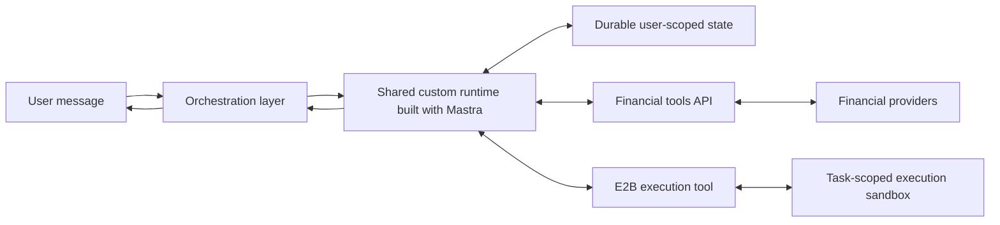
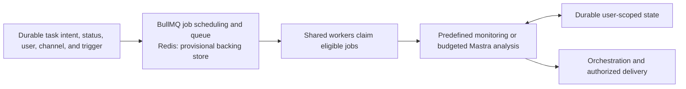

# MyStacks custom runtime architecture

## 1. Direction and scope

**Status: tentative overall design, to be finalized in the architecture design round.** The working design incorporates the component and security decisions recorded in the ADRs: a custom runtime built with **Mastra** on shared application workers, durable state outside worker processes, and scheduled jobs for background work. **E2B is the selected generated-code sandbox; BullMQ with Redis remains the provisional queue choice.** Account, channel, context, and execution mappings below are tentative architectural choices. Hosting, package versions, model providers, interfaces, and detailed operating policies remain open. No runtime implementation exists in this repository.

Phase 1 provides financial information, analysis, and proactive monitoring through **read-only financial access**. It excludes specific buy, sell, or rebalance recommendations and financial execution. Concise chat reports, memory, informational tasks, and messages remain in scope. The runtime must support flexible work within wealth and assets, useful partial answers from available evidence, user-defined ongoing tasks, daily morning digests, and useful independent initiative.

Chat is the default assistant surface after required phone/SMS signup and channel linking. The persistent website dashboard manages financial connections and messaging channels through the same flow for new and returning users, with portfolio previews, Add more, and Continue to chat. Financial connections are optional. iMessage and WhatsApp are the launch channels, separately linked to the same stable MyStacks account. Chat manages its own tasks and shared personal memory; connection removal and channel-routing settings belong on the website.

Phase 1 monitoring starts with checks **every couple of hours or daily**. Device timezone is captured once at onboarding; users explicitly change their default in the web app or chat, and task-specific overrides affect only that task. Existing schedules keep their assigned timezone unless edited. Automatic re-detection on later website visits is deferred. Confirmations show time and zone; exact cadence and recurrence/daylight-saving mechanics remain open. Checks and delivery are best effort. Precision takes priority over recall; some events may be missed. Hosting and queue choices do not strengthen these limits.

Launch planning assumes **1,000 users**, with a **100,000-user growth target**. Whether these figures mean registered or active users remains undefined. They do not determine concurrent workload or worker count.

[Requirements](requirements.md) owns product behavior. Decision rationale belongs to the [runtime ADR](ADRS/0001-custom-runtime-and-orchestration.md), [credentials ADR](ADRS/0002-backend-owned-financial-credentials.md), [code execution ADR](ADRS/0003-sandboxed-code-execution.md), [scheduling ADR](ADRS/0004-durable-scheduling-and-queued-execution.md), [Mastra framework ADR](ADRS/0005-mastra-runtime-framework.md), [agent capabilities ADR](ADRS/0006-composable-agent-capabilities.md), [verified EVM connections ADR](ADRS/0007-verified-evm-wallet-connections.md), and [channel scope ADR](ADRS/0008-channel-scoped-work-and-shared-memory.md). This document owns component responsibilities and execution flows.

The [user stories](user-stories/README.md) describe the complete Phase 1 experience. The [detailed technical designs](design/README.md) develop supporting contracts within this architecture, with proposed choices and unresolved policies kept explicit.

## 2. Components and responsibilities

### 2.1 Canonical terminology

| Term | Meaning |
| --- | --- |
| **MyStacks backend** | Trusted application code that provides orchestration, runtime execution, tools, authorization, and durable state access. These responsibilities need not be separate services. |
| **Existing agentic runtime** | The shared-machine approach represented by `mystacks-be` and `hs-llm-service`, where application orchestration handles conversations and trusted tools execute on shared compute. The approach can support the requirements; the reference implementations do not establish that all required features exist. |
| **Orchestration layer** | Binds incoming work to an authenticated user, routes chat and background jobs, and delivers progress and results to authorized product surfaces. |
| **MyStacks account** | Stable owner of personal memory, financial connections, conversations, and tasks. Its primary verified login phone number is a changeable binding. |
| **Channel binding** | A separately verified relationship between a messaging sender or conversation and a MyStacks account. It does not follow merely from matching phone numbers or email addresses. |
| **Conversation thread** | A channel conversation's messages and current conversational context. Its history and compaction remain separate from other linked channels. |
| **Custom runtime** | MyStacks-owned application built with Mastra's regular `Agent` and native context, tool, skill, and memory facilities. A runtime run is an invocation of this software, not a permanent process assigned to a user. |
| **RequestContext** | Mastra's per-request context. MyStacks creates a fresh instance for each run and binds authorized account, channel, resource, and thread identifiers from trusted backend context. It is distinct from durable memory. |
| **Worker** | A long-lived MyStacks application process that claims queued jobs and runs work. It can handle concurrent runs with separate user contexts; it is not a cloud resource created for each job. |
| **Task** | A durable standing request with intent, current status, user, originating channel, and trigger. Its channel fixes delivery and chat control scope. It remains distinct from the attempts that execute it. |
| **Schedule** | A durable definition of when an informational task becomes eligible to run. |
| **Job** | A queued unit of work that a worker claims for execution. A schedule can produce many jobs over time. |
| **Run attempt** | One execution of queued work, with its own progress and outcome. Retrying work does not create a new standing task. |
| **Skill** | Instructions that guide the runtime's work. A skill does not execute code by itself. |
| **Tool** | An executable capability exposed to the runtime, such as an authorized financial read or isolated code execution. |
| **Financial tools API** | The backend boundary that authorizes financial reads, uses connected-account credentials, and returns evidence to the runtime. |
| **Execution sandbox** | An isolated E2B environment for generated code and selected input belonging to one user's task or analysis session. It does not own the agent loop or schedules. |

### 2.2 Logical ownership

| Owner | Responsibility |
| --- | --- |
| Orchestration layer | Authenticate channel and website requests; resolve and authorize the stable account, channel, and conversation thread; supply trusted run context; route work; recheck current permissions, task status, and channel before delivery. |
| Custom runtime | Use Mastra to execute the agent loop, load relevant context and memory, and compose skills and tools; apply MyStacks financial logic and output limits; check results; maintain informational tasks and required outputs through durable state interfaces. |
| Task boundary | Persist standing task intent, status, user, originating channel, and trigger separately from attempts; enforce current-channel task access and accepted lifecycle policy. |
| Scheduling and queue layer | Persist scheduling and queue state, produce eligible jobs, and coordinate worker claims. It triggers runs rather than reasoning about a user's portfolio. |
| Worker | Execute claimed work through the runtime or a predefined calculation, with the bound user context and configured concurrency. |
| Financial tools API | Verify user, account, and object access; use backend-held connected-account credentials, which no other runtime tool receives; return the shared financial evidence contract to authorized product consumers. |
| E2B execution tool | Accept generated code and selected input, with financial data already returned by the financial tools API; enforce sandbox network and resource policy; return outputs, errors, and artifacts; persist required artifacts and terminate the disposable sandbox when analysis ends. |
| Hosting providers | Supply the selected compute, isolation, storage, and network capabilities. MyStacks retains responsibility for application behavior and authorization. |

The orchestration layer and custom runtime remain logically distinct even when they share a deployment. Routing work to the correct user does not require a separate LLM. Shared compute may be a fleet of processes or machines; it does not imply one large server.

The service deploys common runtime code, curated tools, and skills. User preferences, task instructions, memory, and conversation context vary through durable user-scoped state. The runtime composes these capabilities for financial work without requiring a new hard-coded intent for each analysis. Data coverage and method correctness still limit which analyses it can complete. The [agent capabilities ADR](ADRS/0006-composable-agent-capabilities.md) defines this composition and keeps a credential-injecting API proxy as a future option for demonstrated tool gaps.

### 2.3 Mastra framework boundary

The runtime uses Mastra's **regular `Agent`**, native tool registration, skills, context management, and memory facilities instead of building equivalent engines. Mastra provides agent execution and integrates AI SDK provider interfaces and adapters for model access. MyStacks owns user authentication, user/account/object authorization, financial domain logic, task behavior, notification and delivery controls, data accuracy, and retention. [Mastra agents](https://mastra.ai/docs/agents/overview), [Model providers](https://mastra.ai/models)

A common `Agent` definition can serve many users. Each run receives a **fresh trusted `RequestContext`** and authorized resource and thread bindings; the model cannot choose or replace the user binding. MyStacks must configure and validate those bindings on every entry path. Identifiers and framework storage scopes alone do not confer user permissions. Private run context must not be stored in shared mutable fields on agent definitions. [Request context](https://mastra.ai/docs/server/request-context)

Mastra loads curated skill folders containing `SKILL.md` and any references or scripts. Backend tool modules are explicitly registered trusted code; their availability may vary by authorized user context. Loading a skill does not grant tool rights or execute its scripts or backend code. MyStacks may use native tool hooks and processors for policy and observability, while protected-action authorization remains inside tool handlers or the financial tools API on every path. [Skills](https://mastra.ai/docs/skills), [Filesystem skills](https://mastra.ai/docs/sandbox/skills)

Existing SDKs and native adapters should be used directly when they meet the contract. The E2B execution tool is a necessary application boundary for authorized user data, outbound access, sandbox lifecycle, and artifact persistence. It may use `@mastra/e2b` or the direct E2B SDK; that adapter choice remains an implementation detail. A static shared workspace or live sandbox must not expose private files or execution state across users. [Mastra E2B integration](https://mastra.ai/integrations/sandboxes/e2b)

### 2.4 Tentative account, channel, and context mapping

The orchestrator selects and authorizes the account, channel, and conversation; Mastra loads and manages the selected context through its configured memory facilities. Mastra does not need channel-provider identity rules to distinguish iMessage from WhatsApp. The tentative mapping uses the stable account as the memory resource and the verified channel conversation as its thread. Framework identifiers do not replace authorization.

The [onboarding design](design/onboarding.md) owns signup, button-based linking messages, channel bindings, and website connection controls. The [runtime design](design/runtime.md) owns separate channel histories and compaction, shared account personal memory, and the handoff to Mastra. Both channels read the same logical personal memory and authorized financial evidence. Useful user facts can carry across channels; transcripts, task logs, and results remain in their originating channel. Current financial facts and task state continue to come from protected backend operations.

Background work uses independent agent runs with its own working context while the main chat remains available. Chat lists and manages only jobs and tasks originating in its channel. Task tools derive channel scope from trusted backend context and expose no destination selector or cross-channel transfer. Ordinary chat does not steer an active run; live steering is low priority. These scopes share worker infrastructure and require no permanent runtime or queue per channel.

The [task design](design/tasks.md) owns fixed task delivery and separate proactive routing. Disconnecting a task's channel pauses the task; relinking leaves it paused until the user resumes it from that channel. Proactive messages instead use one preferred channel, initially the first linked channel, with website routing controls and fallback to the remaining linked channel. Account-wide proactive on/off remains a chat preference. The website shows connection previews; portfolio answers in chat are user-requested.

These mappings preserve the agreed product experience and are **tentative until the overall architecture review**. They do not select database schemas, a memory merge mechanism, channel-provider adapters, or live-steering APIs.

## 3. Execution flows

### 3.1 Conversation and continued work

The [architecture diagram](architecture.html) visualizes this flow and the trusted backend boundary. Open the HTML file in a browser to view it.

The orchestration layer establishes trusted account and channel context before routing work. For each run, it supplies fresh `RequestContext` and authorized resource and thread bindings. Mastra loads shared personal memory and that channel's history, then runs the agent with authorized skills and tools. Cross-channel transcript or task retrieval is outside the Phase 1 tool surface. Exact interfaces and whether chat runs enter through the queue remain open.

For longer work, the assistant briefly acknowledges the request, explains the intended work, and provides useful initial information when available. Independent background runs let the user continue chatting, leave and receive results later, or list, check, and cancel work from that channel. Ordinary new messages do not redirect or cancel active runs. Progress messages contain meaningful updates. Required conversation state, task progress, and outputs must survive the worker process that handled them while retaining channel scope. Exact cancellation mechanics remain open; live steering is low priority.

All responses and reports use concise, precise text that is readable in chat, including scheduled results and proactive insights. The runtime leads with the main finding, key numbers, and necessary explanation or evidence; follow-ups provide deeper detail. Substantial source research and code execution remain available behind that output. Image replies are low priority; extensive deep-research reports and polished website report artifacts are deferred. The [runtime design](design/runtime.md) owns response composition within this scope.

### 3.2 Scheduled and proactive work

Task intent, current status, user, originating channel, and trigger persist between runs. The channel fixes delivery and chat access. Run attempts retain their own instructions, progress, and outcomes without replacing the standing task; edits affect future runs. **No LLM needs to keep thinking between runs.** Under the provisional technology choice, BullMQ Job Schedulers produce jobs from repeat settings, and workers claim eligible work. MyStacks uses that scheduling capability rather than building a separate scheduler engine. Current BullMQ does not require a separate legacy `QueueScheduler`. [Job Schedulers](https://docs.bullmq.io/guide/job-schedulers/), [QueueScheduler](https://docs.bullmq.io/guide/queuescheduler)

The queue owns scheduled-job eligibility and job retries; Mastra performs agent execution inside a claimed job. Mastra scheduling or background retry must not independently manage the same work. Advanced facilities such as `AgentController`, durable agents, workflows, or signals may be adopted when a concrete requirement needs them; they are not required by the framework selection.

A schedule establishes eligibility, not an exact execution instant. BullMQ can produce recurring jobs less frequently when preceding work has not begun processing because workers or concurrency are insufficient. Retry, recovery, overlap, interruption, and duplicate-notification mechanisms must implement the accepted lifecycle in the task design; the architecture does not promise exactly-once execution or delivery. [Job production behavior](https://docs.bullmq.io/guide/job-schedulers/)

Risk alerts, morning digests, flexible user-defined tasks, and independent useful initiative use the same financial authority and notification controls. **Routine monitoring uses inexpensive predefined reads and calculations** without a full agent run. Research and flexible or deeper analysis invoke Mastra when needed. Monitoring, agent runs, and sandbox execution must have resource budgets; their limits and behavior on exhaustion remain open. Data collection, risk calculations, agent analysis, and message delivery remain distinct responsibilities whose exact placement is open.

Before delivering task results, the orchestration layer rechecks current permissions, task status, and channel binding. Queued data and permissions captured at run start do not establish delivery authority. A future-only task edit preserves active-run instructions; pause or channel disconnection holds delivery that has not started. Resume schedules the next occurrence without a backlog; cancellation ends recurrence and requests active-run cancellation. Exact interruption, recovery, and duplicate-handling mechanisms remain open.

Users manage their current channel's ongoing tasks in chat; clear supported requests create, change, pause, resume, or cancel tasks immediately and receive a concise confirmation. Material ambiguity requires clarification. An isolated failure keeps recurrence active; recovery should happen automatically where supported, with a brief explanation when requested output cannot be produced and no repeated identical failure notices. **Agent-initiated messages are on by default**, with one account-wide binary on/off setting in chat and preferred-channel routing managed on the website. Task pause, source disconnection, and worker shutdown are separate actions. Pausing a task preserves its durable state. Internal relevance and repeat-suppression policies must preserve low-noise behavior and accepted monitoring limits.

For proactive insights, portfolio evidence, goals, and remembered interests inform relevance. Send only meaningfully new, useful findings supported by strong evidence and meeting attention criteria; otherwise remain quiet. High precision is prioritized while accepting lower recall, without an unvalidated numeric guarantee. Explain why the finding matters and suppress uncertain, minor, repetitive, or low-value findings. Explicitly requested updates remain governed by task intent, including quiet-day summaries. The task design owns the tentative evidence, relevance, and repeat-suppression mechanisms.

When a financial source is explicitly disconnected, a task continues only if remaining authorized evidence still fulfills its request. Otherwise pause it and explain why once in its originating channel. Restoring that source does not resume the task automatically; the user resumes it from that channel at the next scheduled occurrence without a backlog. Temporary provider outages remain failure-recovery cases. The task design owns the tentative mechanism for applying these rules to affected work.

### 3.3 Generated-code analysis

When an analysis needs generated code, the runtime calls the **E2B execution tool**, a trusted backend adapter:

1. The runtime prepares code and selects the input needed for one user's task.
2. The adapter creates or reuses an isolated sandbox bound to that user's task or analysis session and supplies the selected input.
3. E2B executes the code and returns outputs, errors, and artifacts through the adapter.
4. The runtime checks the result, may revise and rerun the code, and then uses supported findings in its answer.
5. MyStacks persists required reports, files, and results outside the disposable sandbox.
6. The adapter terminates the disposable sandbox when the analysis ends, after required artifacts have been persisted.

A live sandbox must not be reused across users. Reuse within one user's analysis session is permitted. **Outbound internet is disabled by default for financial analysis**; trusted backend tools supply required financial and research data. Any task-specific network exception must be explicit in backend policy. Credentials must not enter the sandbox through mounts, environment variables, files, code, or results.

Sandbox pause is not a deletion action. Session limits, interruption cleanup, permitted pause/resume use, and provider retention and deletion behavior remain open within the persist-then-terminate default. E2B supplies isolated code execution and environment management; the Mastra agent loop stays in the shared backend, which also retains scheduling responsibilities. [E2B documentation](https://docs.e2b.dev/), [Sandbox lifecycle](https://docs.e2b.dev/sandbox)

## 4. Durable state and continuity

### 4.1 State ownership

| State | Logical owner |
| --- | --- |
| Identity, connected-account bindings, and financial credentials | MyStacks backend account and authorization boundary. |
| Portfolio observations and evidence used by the connection preview, chat, reports, and digests | MyStacks backend financial data boundary, separate from personalization memory. |
| Conversation history and context summaries | Runtime state boundary using Mastra memory and storage facilities, scoped to the account and originating channel. |
| Personal memory and user preferences | Shared account-level runtime state using Mastra facilities. MyStacks owns selection, update, retention, and forgetting policy. |
| Standing task intent, current status, user, originating channel, and trigger | Task boundary, with one authority for each record and fixed channel delivery. |
| Schedule eligibility, queue claims, and run-attempt progress and outcomes | Scheduling and execution boundaries, distinct from the standing task, under the provisional BullMQ + Redis choice. |
| Required working files, chat results, and enabled generated outputs | Durable storage scoped to the account and originating job/channel, accessible through authorized product interfaces. Image replies are low priority; polished website report artifacts are deferred. |
| Notification preferences and delivery records | MyStacks backend delivery boundary. |

These are logical responsibilities, not a settled database schema. Concrete records, storage engines, and synchronization interfaces remain open. An application database and Redis must not become independent authorities for the same schedule; the implementation must define ownership and any derived scheduling state before introducing copies.

The financial tools API returns a consistent evidence contract for portfolio surfaces and analysis: **source, as-of time or unknown freshness, coverage gaps, and native values and units**. Conversions and aggregation must retain the evidence needed to interpret the result. Missing data remains explicit; it must not become a zero balance or absence of risk. Exact schemas, collection ownership, reuse, and claim-specific freshness policies remain open.

**Tentative calculation direction:** Phase 1 uses provider data without a MyStacks indexer. Reuse suitable provider-calculated values; common calculation code and definitions serve website previews, chat, and monitoring, while E2B handles flexible generated-code analysis. Display values default to USD and preserve native quantities. Distinguish balance changes from investment returns using supported cash-flow evidence. Fetch only needed data and report supported results; exact formulas and historical capabilities depend on provider coverage. Add historical storage or indexing infrastructure only for concrete capability needs, while retaining required durable evidence and outcomes.

### 4.2 Memory policy and user control

MyStacks reuses **Mastra message history, working memory, and storage adapters** with shared personal memory under the account and separate history and compaction per channel conversation. Structured preferences and goals use a backend-owned write policy and validated tools. Useful personal facts learned in one channel can help another; the shared profile must not become a copy of channel transcripts, task records, or results. The schema and native configuration remain open. Live holdings and account permissions come from backend evidence; remembered information cannot override them. [Working memory](https://mastra.ai/docs/memory/working-memory)

The assistant **automatically remembers useful personal context**. Clear new user statements update older personal facts; unclear conflicts prompt clarification only when material to the answer. Assistant interpretations remain distinguishable from user-confirmed facts. Users can inspect and correct memory in chat, forget a specific detail, or clear all remembered personal context. Selection, storage adapters, enabled layers, semantic recall, concurrent-write ordering, retention, and deletion completion remain open. Prompt trimming changes what enters a model request; it does not delete stored information. Forgetting must cover every enabled derived layer, including profiles, summaries, and vectors, as well as source records where required. Clearing personal context must not be presented as deletion of all conversation, financial, or provider records.

### 4.3 Process and sandbox lifecycle

Authoritative conversation, memory, task, and file state lives outside worker processes. A worker may keep temporary context during a run, and an execution sandbox may keep temporary analysis files, but neither replaces durable user-scoped state.

Workers can restart or be replaced without assigning a permanent machine to each user. Application health, interrupted-run recovery, state compatibility, backup/restore, and retention still need policies. Account deletion is deferred; export remains proposed. Memory forgetting retains its accepted scope and completion requirements. Durable state does not by itself settle whether an interrupted run resumes, restarts, or reports failure.

When chat and background runs update the same user's memory or tasks, their updates must preserve consistent user state. The concurrency and ordering policy remains open; a worker or sandbox boundary alone does not settle it.

## 5. Authorization and isolation

### 5.1 Trusted financial access

`check_binance_balance` calling `GET /agentic/binance/balance` is an **illustrative interface**, not an implemented or fixed API contract:

1. The runtime invokes the tool with trusted execution context bound to the authenticated user.
2. The backend authorizes the user, account, and requested object for that protected action. Model-supplied identifiers do not establish authority.
3. The backend adapter retrieves the exchange credential and calls the provider.
4. The tool returns authorized data through the shared financial evidence contract.
5. The runtime answers from that evidence and identifies partial or uncertain conclusions.

The same checks apply to chat, scheduled jobs, and independent analysis. Runtime authentication, token lifetime, revocation, and interfaces remain open.

**Exchange keys, refresh tokens, organization database credentials, and E2B management keys remain in trusted backend code and tool adapters.** They must stay out of model prompts, `RequestContext`, durable job or workflow inputs, traces, generated code, tool results, sandbox mounts, sandbox environment variables, sandbox files, and sandbox outputs. Trusted backend runtime code may use the SDK credentials needed to operate its tools; its model and generated code do not inherit that authority.

The model accesses private backend data through narrow authorized tools, so it has no default ability to read database credentials. To exclude even worker-process access, a separate financial service would hold credentials and permissions would deny the worker access to the credential store. That deployment topology remains open.

### 5.2 Generated-code boundary

Shared workers execute trusted application code and predefined tools. They must not directly execute generated shell, Python, `eval`, or untrusted plugins. Trusted predefined calculation tools can run in the normal backend process; generated code uses the E2B execution boundary.

The architecture does not require an always-on VM or separate kernel for each user. E2B's isolated Linux VM for an execution session is compatible with shared runtime compute. Isolation must be assessed against the selected provider configuration; separate directories in a shared process are not an isolation boundary for generated code. [E2B sandbox model](https://docs.e2b.dev/sandbox)

The adapter must limit selected data and execution resources to the task's needs and enforce the outbound-internet-off default for financial analysis. Exact enforcement, network-exception policy, resource limits, and deadlines remain open. Selected financial data remains sensitive after credentials are removed. Sandbox isolation does not replace backend authorization or prevent allowed code from reading data supplied to it.

### 5.3 Provider trust

Model providers receive the context MyStacks sends. E2B receives selected code and analysis data. Shared hosting and storage providers process the application state they host. Provider security evidence, data terms, processing regions, operator access, network controls, retention, deletion, and export must be evaluated for the chosen configuration before admitting customer financial data.

Choosing E2B as the execution target does not settle those checks. Encryption at rest or a marketing security claim does not establish that a provider cannot access plaintext during processing.

## 6. Operations and capacity

### 6.1 Shared workers and hosting

BullMQ supports concurrency within a worker and across multiple worker processes. Worker count and concurrency must reflect resource use, job duration, and external service limits. [Worker concurrency](https://docs.bullmq.io/guide/workers/concurrency)

**10,000 schedules do not require 10,000 processes.** Capacity planning depends on schedule frequency, average and peak run duration, simultaneous eligibility, and model, financial provider, and sandbox limits. Shared public market data may be reused across runs while private financial reads retain per-user authorization; data reuse and freshness rules remain open.

Warm workers avoid creating a new application container for every job. Jobs can still wait for available capacity, and additional workers still take time to start. Neither shared workers nor a hosting platform provides unlimited scaling or exact-time execution.

Mastra supports self-hosting in compatible application environments, including a deployment on GCP. Cloud Run worker pools are one possible hosting option, not a selected deployment. **Bun and DeepSeek are compatible candidates**, not selected production runtime or model contracts. Provider, regions, process topology, capacity management, fairness, quotas, and cost targets remain open. [Mastra deployment](https://mastra.ai/docs/deployment/overview), [DeepSeek provider](https://mastra.ai/models/providers/deepseek)

### 6.2 Deployment and future boundaries

Common runtime code, tools, and skills deploy to the shared fleet; user configuration remains external to those deployments. MyStacks still needs policies for in-flight work on old code, worker restarts, and compatibility with durable state.

The selection covers **open-source Mastra core**. Mastra cloud and enterprise features are optional and imply no purchase. Package versions and feature license compatibility must be checked when the implementation is pinned.

A persistent isolated agent may be reconsidered if installed user code or process continuity becomes a requirement, or if adopting a personal runtime saves enough engineering to justify its operating model. That would require new lifecycle, security, and integration decisions. A single-user runtime such as OpenClaw must not be assumed to provide the trust boundaries of this shared multi-user backend.

## 7. Open decisions

| Area | Decision still needed |
| --- | --- |
| Framework implementation and interfaces | Mastra package versions, model/provider configuration, chat routing, continued work, native adapters, and any requirement for advanced execution facilities. |
| Scheduling technology | Confirm or replace provisional BullMQ + Redis; settle durable configuration and the authoritative task/schedule record contract. |
| Run semantics | Mechanisms for future-only edits, pause/resume/cancel, retries and recovery, concurrent background runs, exact interruption, and duplicate-notification handling. Live steering remains low priority. |
| Hosting and capacity | Provider, regions, worker topology, concurrency, scaling, resource fairness, quotas, resource-budget limits, and operating cost. |
| E2B configuration | Templates, data transfer, enforcement of default network isolation and any permitted exceptions, resource limits, session lifetime, interruption cleanup, permitted pause/resume use, and required provider evidence and terms. |
| Persistence and portability | Mastra storage adapters and user/thread scopes, other storage engines and formats, retention, backup/restore, export, deletion, and state compatibility. |
| Financial evidence and proactivity | Provider coverage, evidence schemas, collection ownership, public data reuse, valuation and risk methods, claim-specific freshness, recurrence/daylight-saving mechanics, independent triggers, relevance, and repeat suppression. |
| Personalization | Memory schema, selection and retrieval, validated writes, concurrent-write ordering, enabled derived layers, retention, deletion completion, and implementation of the accepted update and chat-control rules. |
| Account and channel mapping | Validate the tentative account/resource and channel/thread split; settle signup/linking mechanics, channel adapters and device handoff, concurrent memory updates, and enforcement of channel-scoped task access and fixed delivery. Phone changes and recovery are low priority. |
| Security and product enforcement | Runtime authentication, credential storage, permission boundaries, domain enforcement, and informational output controls. |
| Operations | Observability for runs, tool calls, queue delay, costs, and deliveries; deployment and interrupted-run policies. |
| Business assumptions | Registered versus active user targets, workload distribution, geographic scope, and per-user cost limits. |

The architecture design round must finalize these tentative choices together within Phase 1 authority and monitoring limits. This document does not constitute an implementation plan.
