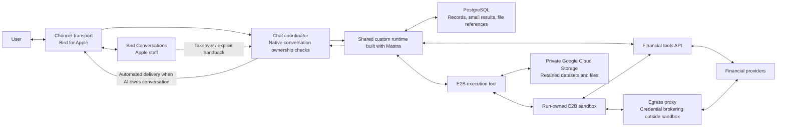
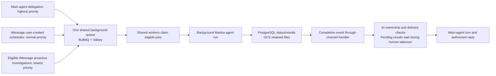

# MyStacks custom runtime architecture

## 1. Direction and scope

**Status: tentative overall design, to be finalized in the architecture design round.** The design incorporates the component and security decisions recorded in the ADRs: a custom runtime built with **Mastra**, direct normal-chat execution in a **GCP Cloud Run Service**, and queued background work on a separate **GCP Cloud Run worker pool**. **E2B supplies a sandbox per execution run for shell, files, and generated code; one Tiger Cloud PostgreSQL database holds application-owned and Mastra-owned tables; private Google Cloud Storage holds retained analysis files; BullMQ uses a dedicated Google Cloud Memorystore for Valkey instance through its Redis-compatible backend.** Durable state lives outside application processes. Channel-turn ordering, main-agent-owned replies, native per-channel compaction, and the memory and background-work boundaries below are agreed Phase 1 direction. Concrete framework mappings, Tiger Cloud configuration, Cloud Run single-coordinator ownership during replacement, deployment configuration, package versions, model providers, provider adapters, interfaces, and detailed operating policies remain open. No runtime implementation exists in this repository.

Phase 1 provides financial information, analysis, and proactive monitoring through **read-only financial access**. It excludes specific buy, sell, or rebalance recommendations and financial execution. Concise chat reports, memory, informational tasks, and messages remain in scope. The runtime must support flexible work within wealth and assets, useful partial answers from available evidence, user-defined ongoing tasks, daily morning digests, and useful independent initiative.

Chat is the default assistant surface after required Privy phone signup through Twilio Verify and independent channel linking. Successful phone verification opens the persistent website dashboard, where financial connections and channel linking can happen in either order. The dashboard manages financial connections and messaging channels through the same flow for new and returning users, with portfolio previews, Add more, and Continue to chat. Financial connections are optional. iMessage and WhatsApp are separately linked to the same stable MyStacks account. **iMessage is the priority channel for chat, one-off analysis/background work, user-created schedules, and proactive reports. WhatsApp supports user-initiated chat and one-off requested analysis/background work; WhatsApp schedules, proactive reports, and template messaging are deferred.** Chat manages supported current-channel tasks and shared personal memory; connection removal and channel linking/disconnection belong on the website. Web and supported chat controls share the account's **proactive insights** setting, which enables or disables eligible iMessage delivery. The [Apple messaging decision](ADRS/0021-apple-messages-with-bird.md) owns channel capabilities and provider selection.

User-requested iMessage monitoring follows the user's confirmed schedule and timezone. Independent proactivity targets **approximately five bounded agent investigations per eligible account each day**, randomly spaced within **09:00–21:00 in the saved user timezone**. The window limits investigation starts; a result may arrive later. Device timezone is captured once at onboarding; users explicitly change their default in the web app or chat, and task-specific overrides affect only that task. Existing schedules keep their assigned timezone unless edited. Automatic re-detection on later website visits is deferred. Confirmations show time and zone; exact recurrence/daylight-saving mechanics remain open. Checks and delivery are best effort. Precision takes priority over recall; some events may be missed. Hosting and queue choices do not strengthen these limits.

Launch planning assumes **1,000 users**, with a **100,000-user growth target**. Whether these figures mean registered or active users remains undefined. They do not determine concurrent workload or worker count.

[Requirements](requirements.md) owns product behavior. The [ADR catalogue](ADRS/README.md) indexes the accepted decisions and their rationale, including runtime, security, channel scope, memory, storage, identity, calculations, and report presentation. This document owns component responsibilities and execution flows.

The [user stories](user-stories/README.md) describe the complete Phase 1 experience. The [detailed technical designs](design/README.md) develop supporting contracts within this architecture, with proposed choices and unresolved policies kept explicit.

## 2. Components and responsibilities

### 2.1 Canonical terminology

| Term | Meaning |
| --- | --- |
| **MyStacks backend** | Trusted application code that provides orchestration, runtime execution, tools, authorization, and durable state access. These responsibilities need not be separate services. |
| **Existing agentic runtime** | The shared-machine approach represented by `mystacks-be` and `hs-llm-service`, where application orchestration handles conversations and trusted tools execute on shared compute. The approach can support the requirements; the reference implementations do not establish that all required features exist. |
| **Orchestration layer** | Binds incoming work to an authenticated user, routes chat and background jobs, and delivers progress and results to authorized product surfaces. |
| **MyStacks account** | Stable internal account ID owning personal memory, financial connections, conversations, and tasks, with a unique `privy_user_id` mapping. Its verified login phone is a changeable binding. |
| **Channel binding** | A separately verified relationship between a messaging sender or conversation and a MyStacks account. It does not follow merely from matching phone numbers or email addresses. |
| **Conversation thread** | A channel conversation's stored messages and current context. Its history and native Mastra Observational Memory compaction remain separate from other linked channels. |
| **Channel event stream** | The logical ordered inbox of user messages and internal background-completion events for one linked channel. It does not imply a separate queue, process, or VM for that channel. |
| **Custom runtime** | MyStacks-owned application built with Mastra's regular `Agent` and native context, tool, skill, and memory facilities. A runtime run is an invocation of this software, not a permanent process assigned to a user. |
| **Main agent** | The conversational agent that processes channel events, uses tools, delegates background work, and owns all agent-authored user replies. |
| **Foreground turn** | One main-agent processing cycle for pending channel events and relevant context. It can contain several model/tool rounds and end with a reply, delegation acknowledgement, or no unnecessary message. Only one runs at a time per channel. |
| **Execution run** | One foreground main-agent invocation or one background job attempt. It owns at most one lazily created E2B sandbox, reused across its execution calls; a continuation or retry is a new run. |
| **Model round** | One model invocation within a foreground turn or background run. It may request several tools whose results feed a later round. |
| **Background subagent** | A separately queued agent run delegated by the main agent that returns internal findings, data, evidence, or artifact references. It cannot spawn subagents or send user messages. Scheduler-started background agent runs use the same restricted capabilities but have separate admission rules. |
| **Completion event** | An internal event referencing a saved background result. It starts or awaits a new main-agent turn with the original request and current permitted channel context. |
| **RequestContext** | Mastra's per-request context. MyStacks creates a fresh instance for each run and binds authorized account, channel, resource, and thread identifiers from trusted backend context. It is distinct from durable memory. |
| **Worker** | A long-lived MyStacks application process that claims queued jobs and runs work. It can handle concurrent runs with separate user contexts; it is not a cloud resource created for each job. |
| **Task** | A durable standing request with intent, current status, user, originating channel, and trigger. Its channel fixes delivery and chat control scope. It remains distinct from the attempts that execute it. |
| **Schedule** | A durable definition of when an informational task becomes eligible to run. A user-created schedule admits each eligible occurrence as an independent background agent run. |
| **Job** | A queued unit of work that a worker claims for execution. A schedule can produce many jobs over time. |
| **BullMQ** | The queue library that supplies timing, dispatch, claims, and job-level retries for shared background work. |
| **Valkey** | The Redis-compatible database used by BullMQ for queue and scheduling state. It is separate from PostgreSQL and from application processes. |
| **Memorystore for Valkey** | Google Cloud's managed hosting product for the project's Valkey instance. It does not execute agents or own personal memory. |
| **Run attempt** | One execution of queued work, with its own progress and outcome. Retrying work does not create a new standing task. |
| **Skill** | Instructions that guide the runtime's work. A skill does not execute code by itself. |
| **Tool** | An executable capability exposed to the runtime, such as an authorized financial read or isolated code execution. |
| **Financial tools API** | The trusted financial authorization and evidence boundary. It supports reusable reads, credential brokering, and a user-bound read API bridge where application signing or proxy-incompatible authentication is required. |
| **Execution sandbox** | An isolated E2B shell, filesystem, and code environment owned by one execution run. Its workspace survives successive calls within that run; the shared Mastra runtime owns reasoning and scheduling. |
| **programmatic tool calling** | Generated code composes authorized SDK/API reads with loops, pagination, concurrency, and local processing without another model invocation after each read. |
| **credential brokering** | An egress proxy attaches provider credentials to authorized outbound requests outside the sandbox; generated code receives data without receiving the raw provider credentials. |

### 2.2 Logical ownership

| Owner | Responsibility |
| --- | --- |
| Orchestration layer | Authenticate channel and website requests; resolve and authorize the stable account, channel, and conversation thread; deduplicate and order channel events; supply trusted run context; start direct main-agent turns or queued background work; recheck current permissions, task status, and channel before delivery. |
| Bird and Bird Conversations | Bird carries Apple Messages for Business messages for MyStacks' account; Bird Conversations provides the Apple-channel staff UI and native conversation ownership integration. The backend enforces the automation pause and explicit return to AI. |
| Custom runtime | Execute Mastra main-agent and background loops in the shared API or worker process, load relevant context and memory, and compose authorized skills and tools; apply MyStacks financial logic and output limits; check results. Main-agent turns own replies and supported changes to memory, preferences, and tasks. |
| Task boundary | Persist standing task intent, status, user, originating channel, and trigger separately from attempts; enforce current-channel task access and accepted lifecycle policy. |
| Scheduling and queue layer | BullMQ with Valkey owns timing, queued dispatch, claims, and configured job retries from backend-registered schedules. It triggers runs rather than reasoning about a user's portfolio. Pinned versions and client integration require validation. |
| Worker | Execute claimed background agent runs with bound user context; persist actual job status and results in the backend database and emit completion events. |
| Financial tools API | Enforce user, account, read-only operation, and object access; bind credential brokering and backend read-bridge access to trusted run context; keep raw provider credentials outside the sandbox; validate evidence for product consumers. |
| E2B execution tool | Create and reuse the owning run's sandbox for shell, files, and code; supply authorized inputs and configure scoped outbound access; enforce network and resource policy; save useful retained files to private Google Cloud Storage and records/references to PostgreSQL before destroying the sandbox. |
| Analysis storage boundary | Authorize account/channel/run access to retained analysis data; keep records, small structured results, metadata, and file references in PostgreSQL and retained datasets/workspace files in private Google Cloud Storage. |
| Web research tools | Search and read public pages through backend tools, supplying relevant evidence without exposing backend secrets or providing access to private infrastructure. |
| Hosting providers | Supply the selected compute, isolation, storage, and network capabilities. MyStacks retains responsibility for application behavior and authorization. |

The orchestration layer and custom runtime remain logically distinct even when they share a deployment. Routing work to the correct user does not require a separate LLM. Shared compute may be a fleet of processes or machines; it does not imply one large server.

The service deploys common runtime code, curated tools, and skills. User preferences, task instructions, memory, and conversation context vary through durable user-scoped state. The runtime composes these capabilities for financial work without requiring a new hard-coded intent for each analysis. Data coverage and method correctness still limit which analyses it can complete. The [agent capabilities ADR](ADRS/0006-composable-agent-capabilities.md) defines broad shell, code, web research, and provider API capabilities. Provider SDKs and skills support **programmatic tool calling** without a bespoke tool for each analysis; **credential brokering** and a thin user-bound backend read API bridge preserve the financial access boundary.

### 2.3 Mastra framework boundary

The runtime uses Mastra's **regular `Agent`**, native tool registration, skills, context management, and memory facilities instead of building equivalent engines. Mastra provides agent execution and integrates AI SDK provider interfaces and adapters for model access. MyStacks owns user authentication, user/account/object authorization, financial domain logic, task behavior, notification and delivery controls, data accuracy, and retention. [Mastra agents](https://mastra.ai/docs/agents/overview), [Model providers](https://mastra.ai/models)

A common `Agent` definition can serve many users. Each run receives a **fresh trusted `RequestContext`** and authorized resource and thread bindings; the model cannot choose or replace the user binding. MyStacks must configure and validate those bindings on every entry path. Identifiers and framework storage scopes alone do not confer user permissions. Private run context must not be stored in shared mutable fields on agent definitions. [Request context](https://mastra.ai/docs/server/request-context)

Mastra loads curated skill folders containing `SKILL.md` and any references or scripts. Backend tool modules are explicitly registered trusted code; their availability may vary by authorized user context. Loading a skill does not grant tool rights or execute its scripts or backend code. MyStacks may use native tool hooks and processors for policy and observability, while protected-action authorization remains inside tool handlers or the financial tools API on every path. [Skills](https://mastra.ai/docs/skills), [Filesystem skills](https://mastra.ai/docs/sandbox/skills)

The channel handler, foreground-turn ordering, background admission, and completion routing are **MyStacks application contracts**. They do not establish an exact Mastra API or require workflow checkpoints. Background subagents receive useful authorized read, research, and code-execution tools and shared personal-memory read access. Backend capability checks prevent them from changing settings, connections, memory, or saved user tasks, sending messages, or spawning children.

Existing SDKs and native adapters should be used directly when they meet the contract. The E2B execution tool is a necessary application boundary for authorized user data, outbound access, sandbox lifecycle, and artifact persistence. It may use `@mastra/e2b` or the direct E2B SDK; that adapter choice remains an implementation detail. Each execution run must resolve its own sandbox from trusted run context. A static live workspace must not be shared across users or concurrent runs. [Mastra E2B integration](https://mastra.ai/integrations/sandboxes/e2b)

### 2.4 Tentative account, channel, and context mapping

The orchestrator selects and authorizes the account, channel, and conversation; Mastra loads and manages the selected context through its configured memory facilities. Mastra does not need channel-provider identity rules to distinguish iMessage from WhatsApp. The tentative mapping uses the stable account as the memory resource and the verified channel conversation as its thread. Framework identifiers do not replace authorization.

The [onboarding design](design/onboarding.md) owns Privy and Twilio Verify signup, QR and button-based linking messages, channel bindings, and website connection controls. The backend verifies the Privy access token with its native SDK and maps the verified subject to a stable internal account through a unique `privy_user_id`. The first authenticated API request creates that account idempotently if absent, without waiting for a webhook. The verified phone comes from Privy, not a request-body assertion. The existing phone-login POC is a working reference reported by the user; it does not define our authorization contract. The [runtime design](design/runtime.md) owns separate channel histories and compaction, shared account personal memory, and the handoff to Mastra. A channel's model context combines recent raw messages, its compact notes, and the account-shared structured profile. Useful user facts can carry across channels through that profile; transcripts, task logs, and results remain in their originating channel. Phase 1 provides neither vector retrieval nor cross-channel history retrieval. Current financial facts and task state continue to come from protected backend operations.

Background work uses independent agent runs with its own working context while the main chat remains available. Their internal results return through a new main-agent turn; the resulting reply joins normal channel history. Chat lists and manages only jobs and tasks originating in its channel. Task tools derive channel scope from trusted backend context and expose no destination selector or cross-channel transfer. Ordinary chat does not steer an active foreground or background run. These scopes share worker infrastructure and require no permanent runtime or queue per channel.

The [task design](design/tasks.md) owns fixed task delivery and proactive eligibility. Disconnecting a task's channel pauses the task; relinking leaves it paused until explicit resume from that channel. Proactive insights are enabled by default for eligible linked iMessage, subject to applicable channel permissions. WhatsApp linking does not enable proactive work, and WhatsApp cannot be selected for it. The account setting is shared by website and supported chat controls. A WhatsApp scheduling request receives an explanation and a link to the user's linked iMessage; WhatsApp cannot create or manage iMessage tasks or retarget work. The website shows connection previews; portfolio answers in chat are user-requested.

Human support is an accepted channel capability during published working hours. **Bird Conversations is the Apple-channel staff UI.** The backend enforces one conversation owner from the provider's native ownership integration: human takeover pauses automated replies until staff explicitly return control, and new inbound messages do not resume AI. Requested analyses and user-created schedules continue and save results while their automated reports wait. Proactive investigations do not start while automated delivery is unavailable; running findings wait and are considered on explicit handback only if still useful and eligible. The [conversation ownership decision](ADRS/0022-human-support-conversation-ownership.md) owns that contract, and the [runtime design](design/runtime.md) owns its application. Staffing, hours, SLAs, exact Bird integration, and WhatsApp transport/staff integration remain open in [TODO](TODO.md#2-human-support).

**Bird is the primary Messaging Service Provider (MSP) for MyStacks' Apple Messages for Business account.** iMessage is the product shorthand for that channel, not a direct consumer iMessage API. Bird carries messages; the MyStacks backend retains Mastra execution, memory, and scheduling. Native APIs/webhooks are the integration direction; exact product/API version and configuration remain open. Photon is a backup integration plan, without automatic failover or an assumed same-number/thread migration. The [Apple messaging decision](ADRS/0021-apple-messages-with-bird.md) owns the rationale. Business verification alone does not grant direct Apple API access; account approval/experience review, permitted financial notification scope, and required notices and opt-outs remain validation items in [TODO](TODO.md#1-apple-messaging).

The account/resource and channel/thread mappings remain **tentative until the overall architecture review**. Database schemas, concrete framework configuration, and channel-provider adapters remain open within the accepted storage, memory, channel-turn, and work boundaries.

### 2.5 Financial provider integration

The [provider decision](ADRS/0018-managed-financial-data-providers.md) selects **SnapTrade** for target Binance, Coinbase, Interactive Brokers (IBKR), moomoo, and Robinhood accounts; **Zerion** for supported EVM and Solana wallets; and the direct **Hyperliquid API** at low priority. The audience has mixed, global accounts, while actual regions, account types, products, and history remain provider-driven. DeBank is an optional future complement for demonstrated EVM gaps. Bybit, Upbit, and prediction-market connectors are deferred without restricting general finance questions or research.

The [onboarding design](design/onboarding.md) owns provider setup and verified connection binding; the [portfolio design](design/portfolio.md) owns read adapters and evidence. Hyperliquid setup reuses an eligible verified EVM wallet or verifies new control through a readable challenge, then binds the actual user account address. Its documented public information reads need no user private key, OAuth token, or trading key, while MyStacks still authorizes the user's active verified connection. Chat, schedules, and proactive work use the same trusted connector. Initial reads use on-demand REST through **Webshare** as backend outbound transport; WebSockets require a demonstrated need. Proxy pool, type, count, region, rotation, routing, and limiting remain open. Hyperliquid limits apply per exit IP, including workers sharing an exit; Webshare does not establish a capacity or freshness guarantee. Proxy authentication stays in the trusted backend.

Provider selection does not establish complete current coverage. SnapTrade's delayed IBKR feed and moomoo regional limits remain unresolved for the intended audience. Polling guidance, permitted proactive use, retained-evidence terms, and Zerion source-time semantics also require validation under the [provider decision](ADRS/0018-managed-financial-data-providers.md) and [integration TODO](TODO.md#3-financial-provider-integration). Provider account modes, shared collateral, and overlapping Zerion/Hyperliquid evidence must not cause double counting. History remains provider-bounded without a MyStacks indexer.

## 3. Execution flows

### 3.1 Conversation and continued work

The [architecture diagram](architecture.html) visualizes this flow and the trusted backend boundary. Open the HTML file in a browser to view it.



The orchestration layer verifies, deduplicates, and stores an inbound message, promptly acknowledges transport receipt, and executes normal chat **directly in the backend when AI owns the conversation**. The backend checks native conversation ownership before automated replies; human ownership persists until explicit staff handback, including across new inbound messages. The initial design accepts that process or deployment interruption can leave an acknowledged turn without a reply; saved messages alone do not resume inference. Chat-turn execution remains callable independently of the transport so dispatch can change when a concrete requirement justifies it.

**One active ordinary API/backend process coordinates chat for all users in Phase 1.** Different channels can execute concurrently, while each linked channel has one logical ordered event stream and **one foreground main-agent turn at a time**. User messages and background completions enter the same channel handler; ordering can stay in-process. A turn consumes pending user messages and/or completion events with relevant channel context and may perform several model/tool rounds. Events arriving during an active turn wait for a later turn and may be handled together. Distributed channel ownership is deferred until observed capacity or availability needs justify multiple active coordinators.

For every run, the backend supplies fresh trusted `RequestContext` and authorized resource and thread bindings. Mastra loads the shared profile and the channel context described in section 4.2. Cross-channel transcript or task retrieval is outside the Phase 1 tool surface. Quick work runs inline. For substantial work, the main agent explicitly starts background subagents, receives accepted job IDs, acknowledges the work as appropriate, and ends its turn so new questions and status requests can proceed.

The configurable initial limit is **five outstanding queued or running main-agent-delegated background subagents per chat**. Terminal jobs and scheduler-started runs do not count; the main agent reports capacity rather than accepting a sixth delegation. Only main-agent turns may spawn subagents, and backend capability checks enforce that boundary. Further delegation by a main-agent continuation counts against the same limit. Actual jobs retain statuses, results, and original-request references; the main agent uses job-status tools for claims about running work and decides from context whether the user's request is answered.

When a background run completes, its worker saves the result in PostgreSQL before completing the BullMQ job. **The coordinator subscribes to native BullMQ `QueueEvents` completion notifications.** Its listener resolves trusted stored bindings and queues completion in the same channel handler used by inbound chat. User-requested work retains its originating account, channel, original-request, and job references. Proactive completion serves eligible linked iMessage from one saved investigation under the task delivery policy. An idle AI-owned channel starts a **new main-agent turn**; a busy or human-owned channel retains the event. Requested analyses and schedules continue and save results during human takeover; their automated reports wait for explicit staff handback. The main agent then assesses pending results with correct timestamps, current evidence, and delivery checks. A running proactive finding is considered only if still useful and eligible. Fresh input includes the original request, a compact completion summary and saved result references, and current permitted channel context. The main agent retrieves further result details when useful and can use financial tools or E2B, combine children, delegate more top-level work, reply, or end quietly while another child continues. It owns every agent-authored user reply; completion is internal evidence rather than a new instruction or permission.

PostgreSQL is authoritative for job state and results; the notification signals that work is ready. BullMQ's [event stream](https://docs.bullmq.io/guide/events/) has bounded retention. Saved completions retain **pending or handled state**. On startup and periodically, the coordinator checks for pending saved completions and routes them through the same ordered channel handler, rechecking current authorization, cancellation, and delivery eligibility. An empty check invokes no model, and recovery reuses completed research. Exact schemas, check interval, handled boundary, cursor and retention settings, crash behavior, and duplicate handling remain open. Native event notification and recovery do not establish exactly-once main-agent turns or external replies.

Required messages, job state, and results persist outside the worker. When cancellation is requested, the backend records the request, cancels waiting work, and asks running work to stop through native SDK mechanisms where available. It suppresses unsent results, including late completions. The assistant promptly acknowledges the request and confirms stopped execution or a terminal cancelled outcome only when known; status remains queryable without a required second routine notification. In-flight provider requests may finish and incur cost, and already-submitted messages may not be recallable. Exact status names and interruption integration remain open. The [channel-turn decision](ADRS/0009-channel-turns-and-background-subagents.md) owns the rationale; the [runtime design](design/runtime.md) owns mechanics and examples.

For outbound replies and reports, use provider-supported idempotency, deduplication, or delivery-status checks where available. WhatsApp one-off replies follow the provider's normal messaging window; template messaging remains deferred. If submission remains ambiguous, record that uncertainty and do not blindly resend automatically. Keep the saved result available when the user asks. This accepts that a report may not arrive automatically. Notification or delivery failures never rerun completed analysis; the retry policy for definitive send failures remains open.

All responses and reports use concise, precise text that is readable in chat, including scheduled results and proactive insights. The runtime leads with the main finding, key numbers, and necessary explanation or evidence; follow-ups provide deeper detail. Substantial source research and code execution remain available behind that output. Image replies are low priority; extensive deep-research reports and polished website report artifacts are deferred. The [runtime design](design/runtime.md) owns response composition within this scope.

### 3.2 Scheduled and proactive work



All three background job classes share one execution queue across accounts and a common worker pool. The backend assigns priorities explicitly; normal chat executes directly outside this queue. Priority orders waiting work without interrupting active runs or reserving slots, so even high-priority work can wait for capacity. Trusted run context, permissions, admission, and retries remain specific to each job. The [scheduling ADR](ADRS/0004-durable-scheduling-and-queued-execution.md) owns this shared-capacity trade-off; the [task design](design/tasks.md#22-backend-definitions-and-queue-execution) defines its execution contract.

The **backend database owns saved task definitions and actual background run records, statuses, and results**. Task intent, current status, user, originating channel, and trigger persist between runs. The channel fixes task delivery and chat access. Run attempts retain their own instructions, progress, and outcomes without replacing the standing task; edits affect future runs. **No LLM needs to keep thinking between runs.** Backend code registers recurring schedules; BullMQ Job Schedulers produce eligible jobs from repeat settings and warm workers claim them, with exact mapping still requiring validation. Valkey stores queue and schedule data; it does not start a stopped worker service. MyStacks uses native scheduling rather than building another scheduler engine. Current BullMQ does not require a separate legacy `QueueScheduler`. [Job Schedulers](https://docs.bullmq.io/guide/job-schedulers/), [QueueScheduler](https://docs.bullmq.io/guide/queuescheduler)

BullMQ owns timing, dispatch, claims, and configured job-level retries; Mastra performs agent execution inside a claimed job. Mastra scheduling or background retry must not independently manage the same work. Application state remains authoritative for saved task intent and run outcomes; concrete schedule mappings and recovery integration remain open within the whole-job policy below.

Backend scheduling tools admit user-created schedules only from iMessage and enforce a configurable **minimum one-hour interval** and **five enabled user-created recurring tasks per iMessage chat**. Paused tasks do not consume this saved-schedule quota; enabling or resuming must respect it. For a shorter request, explain the limit and offer hourly without silently changing the schedule. WhatsApp requests receive an explanation and a link to linked iMessage without creating or retargeting work. Normal chat and explicitly requested one-off work keep their own execution rules.

Each eligible user-created scheduled occurrence admits **one independent background agent run**, outside the main-agent delegation quota. A previous occurrence still being queued or running does not delay or suppress the next one; both may run in parallel. Current task, channel, and financial-authority checks still apply. Admission is distinct from actual worker start, which depends on capacity. BullMQ can produce recurring jobs less frequently when earlier work has not started; its native schedule mapping requires integration verification. The architecture does not promise exact-time execution, exactly-once delivery, or outage catch-up. [Job production behavior](https://docs.bullmq.io/guide/job-schedulers/)

**User-requested background work has at most two whole-job execution attempts**, per one-off job or scheduled occurrence. If a worker interrupts unfinished work, restart the job from the beginning only while it remains active and authorized and has an attempt left. The existing single retry for a known temporary scheduled-execution failure uses this same allowance; interruption does not add attempts. The main agent receives terminal failure for a concise explanation, while recurrence stays enabled and repeated identical failure notices remain suppressed. Temporary-failure classification, retry delay, and non-interruption one-off failure handling remain open within this ceiling. Tool or SDK retries have a distinct scope.

Recovery operates at the job boundary. Use native BullMQ shutdown, reconnection, and stalled-job recovery while enforcing the shared two-total-attempt ceiling; configuring an ordinary retry count alone does not establish that all interruption paths share that allowance. Restart unfinished eligible work from the beginning, without checkpoints inside reasoning, model calls, or tool steps. Reuse completed saved results; notification or delivery failure must not rerun successful research or calculation. Cancellation requests and revoked authority prevent restart. Application startup consumes existing queue state rather than recreating every pending job. The [scheduling decision](ADRS/0004-durable-scheduling-and-queued-execution.md#27-whole-job-recovery-and-shared-attempt-allowance) owns this trade-off; definitive transport-failure retry details remain separate from the accepted uncertain-send policy.

Scheduled agent runs can use predefined reads and calculations as tools. **Every eligible proactive check starts a bounded agent investigation** without a cheaper data-change prefilter or rule-trigger prerequisite. Defined investigation scopes guide this work; they do not restrict user-created finance jobs. Resource limits for checks, agent runs, and sandbox execution remain open. Data collection, risk calculations, agent analysis, and message delivery remain distinct responsibilities.

Proactive investigations require enabled proactive insights and verified linked iMessage that is currently eligible for automated delivery, both when scheduling eligible accounts and when queued work starts. Human ownership makes that channel unavailable, so skip investigations while it remains human-owned. Each investigation runs once for the account and can produce an iMessage insight. The configurable product default targets approximately five investigations per eligible account per day at randomized times within 09:00–21:00 in its saved timezone. Only one proactive investigation runs per account; overlapping occurrences are skipped, and missed checks do not accumulate a catch-up backlog. The window limits actual investigation starts, so a run starting at 20:58 may produce a reply at 21:03. Exact native scheduling integration and numeric investigation budgets remain open.

Before delivering task results, the orchestration layer rechecks current permissions, task status, channel binding, and native AI conversation ownership. Queued data and permissions captured at run start do not establish delivery authority. A future-only task edit preserves active-run instructions; pause, channel disconnection, or human ownership holds delivery that has not started. Human ownership leaves requested execution and schedules running; explicit staff handback lets the main agent handle saved results under current checks. Resume of a paused task schedules the next occurrence without a backlog. Cancelling a standing task ends recurrence, cancels its waiting occurrences, requests that running occurrences stop, and suppresses their unsent results immediately after the request is recorded. Acknowledging that request does not claim that execution has already stopped. Exact SDK integration and duplicate handling remain open.

Users manage their current channel’s ongoing tasks in chat; the assistant immediately applies clear supported requests to create, change, pause, resume, or cancel tasks within the applicable limits and gives a concise confirmation. Material ambiguity requires clarification. Website and supported chat controls update the same account proactive insights setting. Disabling it stops future investigations and suppresses unsent proactive findings. Linking WhatsApp does not enable proactive work. User-requested iMessage schedules retain their own controls. Task pause, source disconnection, and worker shutdown are separate actions.

For proactive insights, portfolio evidence, shared personal memory, and account-level finding and notification history inform relevance. That history stays separate from personal memory and distinguishes saved candidates from what was actually sent, when, and with what supporting evidence, including when proactive insights are disabled and later enabled. The main agent judges semantic usefulness and newness; backend policy controls eligibility, recognized duplicate attempts, and current delivery authority. Send only meaningfully new, useful findings supported by strong evidence; otherwise remain quiet. High precision is prioritized while accepting lower recall without a numeric guarantee. Explicitly requested updates remain governed by task intent, including quiet-day summaries.

Before each proactive send, recheck the proactive insights setting, verified iMessage binding, AI conversation ownership, current eligibility, cancellation, and authority. Record actual delivery outcomes separately from saved candidates and investigation success. Proactive investigation failure or worker interruption is recorded internally and waits for the next scheduled check, without whole-investigation automatic retry or a routine user failure message. Transport delivery failures must not rerun the investigation. Provider-supported idempotency or status checks may resolve an ambiguous submission; if it remains uncertain, record it without automatic resend. Definitive send-failure retry details remain open. The [task design](design/tasks.md) owns detailed scheduling, completion, eligibility, and failure policies.

When a financial source is explicitly disconnected, a task continues only if remaining authorized evidence still fulfills its request. Otherwise pause it and explain why once in its originating channel. Restoring that source does not resume the task automatically; the user resumes it from that channel at the next scheduled occurrence without a backlog. Temporary provider outages remain failure-recovery cases. The task design owns the tentative mechanism for applying these rules to affected work.

### 3.3 Shell, code, and multi-step analysis

The shared Mastra runtime owns reasoning and tools in the API or worker process; E2B runs generated programs rather than the full agent. When a foreground invocation or background job attempt first needs shell or generated code, its trusted adapter creates **one E2B sandbox for that execution run**. Successive file operations, shell commands, and Python or JavaScript calls reuse that workspace. A model round or shell command does not create another sandbox.

The **programmatic tool calling** pattern lets a generated program combine broad provider SDK/API reads, loops, pagination, concurrency, filtering, and calculations without sampling the model after each read. The model receives useful outputs and decides whether further work is needed. Adopting this architectural pattern does not select a model or enable a vendor-specific API feature. [Claude's programmatic tool calling documentation](https://platform.claude.com/docs/en/agents-and-tools/tool-use/programmatic-tool-calling) describes a vendor implementation of this pattern.

1. The backend binds the run to its authenticated user, read-only operations, and authorized objects, then supplies selected datasets and scoped programmatic access. Raw provider credentials stay outside sandbox files, environment variables, and generated code.
2. The agent inspects files with shell tools, writes scripts, and runs calculations. Native workspace and execution SDKs provide these capabilities.
3. For supported HTTPS/provider authentication, a native egress proxy performs **credential brokering** outside the sandbox. Where application signing or proxy-incompatible authentication is required, generated programs use the user-bound backend read API bridge. Both paths enforce trusted run/user, read-only operation, and object scope; the exact run-authentication mechanism remains open.
4. Separate backend web search and page-reading tools supply public research. Large authorized datasets may be materialized as run files, with summaries and file references in model context rather than every raw row.
5. The agent checks outputs, fixes code, and repeats within the same workspace, preserving evidence and financial interpretation requirements.
6. The backend saves useful provider inputs actually used, reusable intermediate calculations, final results, and supporting evidence before destroying E2B. PostgreSQL holds records and small structured results; private Google Cloud Storage holds retained datasets and workspace files with PostgreSQL metadata/references. A background run returns saved results to the main agent through the normal completion flow; it does not send the user a reply.

Data transfer is incremental throughout the run. The worker can fetch another authorized dataset or public research result, write additional files through the E2B SDK, and invoke the next calculation in the same workspace. The sandbox is neither a one-time input bundle nor a copy of the shared backend filesystem. Generated programs read provider data through credential brokering or the user-bound bridge. Every transfer retains the run's user/object binding and evidence metadata; model context may contain only a preview and file reference. This data flow supports the running agent's own work and does not introduce steering from later main-chat messages.

The following background analysis illustrates repeated execution in one workspace, with provider credentials attached outside the sandbox or used by the backend read API bridge.

```mermaid
sequenceDiagram
    participant U as User
    participant M as Main agent / coordinator
    participant H as Bird Conversations staff
    participant Q as BullMQ
    participant W as Mastra background worker
    participant S as E2B sandbox for this run
    participant X as Egress proxy outside sandbox
    participant B as Backend read API bridge
    participant P as Financial provider
    participant D as PostgreSQL records and references
    participant G as Private Google Cloud Storage
    U->>M: Analyze my portfolio history
    M->>Q: Enqueue background analysis
    M-->>U: Acknowledge; chat remains available
    Q->>W: Claim job
    W->>X: Configure authorized credential brokering
    W->>S: Create sandbox when execution is needed
    Note over W,S: Mastra/model loop stays in the worker
    loop Fetch, inspect, calculate, and check
        W->>S: Run shell or code
        opt Programmatic provider reads without model resampling
            alt Supported HTTPS/provider authentication
                S->>X: Request this user's permitted read
                X->>P: Attach credential outside sandbox
                P-->>X: Data
                X-->>S: Data
            else Application signing or proxy-incompatible authentication
                S->>B: Request read with scoped run authorization
                B->>B: Check trusted user, read, and object scope
                B->>P: Authorized provider request
                P-->>B: Data
                B-->>S: Data
            end
        end
        S-->>W: Outputs and errors
        W->>W: Reason and choose the next step
        opt Additional backend-fetched inputs
            W->>P: Fetch authorized data through backend tools
            P-->>W: Data and evidence metadata
            W->>S: Write additional run files through SDK
        end
    end
    W->>G: Save useful retained datasets and files
    W->>D: Save results, evidence metadata, and file references
    W->>S: Destroy sandbox
    W->>Q: Complete job after saving result
    Q-->>M: Completion event
    M->>D: Read saved findings
    opt Useful retained files needed in this new run
        M->>G: Read authorized files through backend transfer
    end
    opt Human owns conversation
        Note over M,U: Keep result pending until explicit staff handback
        H-->>M: Explicit handback through native ownership integration
    end
    M->>M: Check ownership, usefulness, timestamps, and delivery authority
    M-->>U: Concise report
```

Every main-agent continuation and every retried job attempt is a new execution run. It may read authorized saved outputs and create its own sandbox if needed, but it does not inherit another run's live processes or interpreter state. Whole-job recovery starts a fresh environment; native language-context reuse within one run is not a reasoning checkpoint mechanism.

Sandbox networking denies outbound access except required provider and backend read-bridge destinations admitted by trusted backend policy. Runs without external API needs can remain offline. The backend owns network configuration, credential selection, and shared-object access; generated code cannot widen its authority. Generated code necessarily receives the current user's authorized financial data for analysis. **This data exposure is an explicitly accepted, necessary trade-off.** Financial data can still be disclosed through outputs, permitted outbound requests, or sensitive web-tool queries; credential brokering and domain rules do not guarantee prevention of data exfiltration. The [credential decision](ADRS/0002-backend-owned-financial-credentials.md) owns this boundary and trade-off.

E2B is ephemeral, not a new process for every command or a permanent machine for each user. Required outputs outlive it. Pause retains state and is not destruction; time limits, interruption cleanup, provider retention, and native integration remain implementation choices. [E2B execution](https://docs.e2b.dev/), [Mastra E2B integration](https://mastra.ai/integrations/sandboxes/e2b)

## 4. Durable state and continuity

### 4.1 State ownership

| State | Logical owner |
| --- | --- |
| Identity, connected-account bindings, and financial credentials | MyStacks backend account and authorization boundary. |
| Portfolio observations and evidence used by the connection preview, chat, reports, and digests | MyStacks backend financial data boundary, separate from personalization memory. |
| Conversation history and compact notes | Mastra-owned PostgreSQL tables using native memory and Observational Memory facilities, scoped to the account and originating channel. |
| Personal memory and personal preferences | Account-shared native Mastra structured working memory in Mastra-owned PostgreSQL tables, with a few stable categories and flexible free-text content. Main-agent turns control profile writes under backend authority. |
| Standing task intent, current status, user, originating channel, and trigger | Backend database through the task boundary, with fixed channel delivery. |
| Background job status, cancellation requests, original-request references, progress, results, and pending/handled completions | Backend database through the execution boundary, scoped to the authorized account and channel. |
| Registered schedule timing, queued dispatch, and claims | BullMQ using the dedicated Valkey queue store, derived from authorized backend task definitions. |
| Useful retained provider inputs, reusable calculations, final results, and supporting evidence | Private Google Cloud Storage for retained datasets/workspace files; PostgreSQL for records, small structured results, metadata, and file references, scoped to the account and originating run/channel. Image replies are low priority; polished website report artifacts are deferred. |
| Notification preferences and delivery records, including uncertain submissions | MyStacks backend delivery boundary. |
| Proactive finding and notification history | Account-level backend evidence and delivery records, separate from personal memory; retain actual sent findings and their supporting evidence when proactive insights are disabled and later enabled. |

**One Tiger Cloud PostgreSQL database** holds separate application-owned and Mastra-owned tables; it is not a database per user. MyStacks backend authorization governs access to both. Application-owned tables hold task intent, run outcomes, account state, delivery records, small structured results, and file metadata/references; Mastra-owned tables hold its messages and memory state through the native PostgreSQL adapter. Use a TimescaleDB-enabled service with ordinary application and Mastra tables. Future portfolio-history tables begin as hypertables from their first write when that infrastructure is built; Phase 1 still defers a MyStacks indexer. Region, service plan, sizing, concrete schemas, package versions, and synchronization interfaces remain open. The [PostgreSQL decision](ADRS/0013-shared-postgresql-storage.md) owns that database choice.

The [analysis retention decision](ADRS/0023-analysis-data-retention-and-object-storage.md) selects **private Google Cloud Storage for retained datasets and workspace files**, while PostgreSQL owns records, small structured results, metadata, and file references. Storage follows purpose rather than a mandatory size threshold; a small tool response need not become a file. Retain useful provider inputs actually used, reusable intermediate calculations, final results, and supporting evidence conservatively, subject to provider data rights. Automatic pruning is deferred. Keep account/channel/run ownership, data type, saved time, retrieval time, source as-of time or unknown, provider/connection, size, and storage reference metadata for identification and later cleanup; exact schemas remain open. Examples include provider transaction/trade history, price/position datasets, and cleaned/joined analysis files. Retained files support follow-ups without promising exact process replay or persistence of every scratch file or log.

The backend controls account/channel-scoped GCS access through native SDKs and run-scoped transfers; agents and sandboxes receive neither broad cloud credentials nor unrestricted bucket access. Useful files are saved before sandbox destruction, and a later authorized run may restore chosen files into its fresh sandbox. Exact transport and deployment configuration remain open. Retained evidence does not replace fresh inputs for current claims, and this storage is not a continuous portfolio-history archive or Phase 1 indexer.

BullMQ uses the project's dedicated Valkey instance for timing, queued dispatch, and claims under the [queue-storage decision](ADRS/0020-managed-valkey-queue-storage.md). Its mapping and update/recovery contract must preserve PostgreSQL authority for task intent and run outcomes rather than letting both stores make independent scheduling decisions. Application and queue updates are not one atomic transaction; exact integration remains open.

Backend tools and direct sandbox reads must produce the same validated evidence contract for portfolio surfaces and analysis: **source, source-data time or unknown freshness, retrieval time, coverage gaps, and native values and units**. Conversions and aggregation must retain the evidence needed to interpret the result. Missing data remains explicit; it must not become a zero balance or absence of risk. Exact schemas, collection ownership, and reuse windows remain open.

The [current-evidence decision](ADRS/0019-current-portfolio-evidence.md) requires fresh or near-fresh relevant account evidence for current portfolio analysis and account-specific proactive conclusions. Request the latest relevant provider data at analysis time, allowing brief appropriate reuse. Account-state freshness and market-price freshness are separate; fresh prices cannot make old holdings current, and retrieval time cannot substitute for source-data time. Delayed evidence can support bounded historical or reporting claims. If timely evidence is unavailable, avoid proactive current-exposure conclusions that depend on it; requested answers remain best effort with concise material limitations and other supported answers remain available. Exact maximum ages and service levels stay open. Approximately five daily proactive checks remain periodic detection, not continuous monitoring.

**Accepted data scope; tentative calculation mechanisms:** Phase 1 aggregates current provider data without a MyStacks indexer. EVM and Solana wallet sources require verified wallet control through the onboarding boundary. Reuse suitable provider-calculated values; common calculation code and definitions serve website previews, chat, and monitoring, while E2B handles flexible generated-code analysis. Display values default to USD and preserve native quantities. Distinguish balance changes from investment returns using supported cash-flow evidence. Fetch only needed data and report supported results; exact formulas and historical capabilities depend on provider coverage. Historical P&L and reconstruction requiring MyStacks-owned history collection or indexing infrastructure are deferred at low priority. Provider-supplied history and metrics remain usable where supported; required durable evidence and outcomes are retained.

### 4.2 Memory policy and user control

MyStacks uses **native Mastra Observational Memory** for token-budgeted compaction within each channel. Model context combines recent raw messages, compact notes from that channel, and the account-shared structured profile. Compaction changes prompt context without deleting stored raw history. Exact thresholds, compaction models, and configuration remain open; vendor defaults of roughly 30,000 raw message tokens before activation and 6,000 raw message tokens retained afterward are illustrative, not selected limits. The [context compaction decision](ADRS/0010-native-channel-context-compaction.md) owns this choice. [Observational Memory](https://mastra.ai/docs/memory/observational-memory)

Account-shared personal memory uses **native Mastra structured working memory**, with a few stable categories and flexible free-text content. Main-agent turns update the profile through the native update tool under backend-controlled authority; research and background agents have read access only. Observational Memory maintains channel notes and does not automatically update the shared profile. Exact category keys, schema, and profile size and selection budgets remain open. The [shared-memory decision](ADRS/0008-channel-scoped-work-and-shared-memory.md) owns the scope, and the [runtime design](design/runtime.md) owns representation details. [Working memory](https://mastra.ai/docs/memory/working-memory)

The assistant **automatically remembers useful personal context**. Clear new user statements update older personal facts; unclear conflicts prompt clarification only when material to the answer. Assistant interpretations remain distinguishable from user-confirmed facts. The profile holds useful personal context rather than copies of transcripts, task records, or results. Live holdings and account permissions come from backend evidence; remembered information cannot override them.

Native partial profile updates preserve distinct fields. For the same field, the **last successful save wins**, including an older, slower turn overwriting a correction or deletion. MyStacks adds no application locking, write ordering, or tombstones; PostgreSQL's internal atomic-merge row locking remains part of the native adapter. A fact within a free-text field still requires editing that field's text. The [profile update decision](ADRS/0012-last-save-wins-profile-updates.md) owns this accepted trade-off.

Users can inspect and correct the profile in chat. **Forget** removes a detail through the same profile update tool; **forgetall** clears the profile. Both leave stored histories and compact notes unchanged. Those retained records can still influence answers or cause a fact to be learned again, so forgetting is best effort. It does not delete conversation, financial, or provider records. The [profile forgetting decision](ADRS/0011-profile-only-forgetting.md) owns this boundary and its trade-offs.

### 4.3 Process and sandbox lifecycle

Authoritative conversation, memory, task, and file state lives outside worker processes. A worker may keep temporary context during a run, and an execution sandbox may keep temporary analysis files, but neither replaces durable user-scoped state.

Workers can restart or be replaced without assigning a permanent machine to each user. PostgreSQL and Valkey retain their state independently of application deployments. Native BullMQ shutdown, reconnection, and stalled-job recovery handle the queue lifecycle within the accepted job policy; deployment does not require an empty queue or a separate restart state machine. Normal chat accepts the interrupted-reply limit in section 3.1. Requested background work restarts from the beginning within its shared two-attempt allowance; proactive investigations wait for the next check, and saved results return through pending-completion recovery without repeating analysis. Exact attempt accounting, application health, state compatibility, backup/restore, and retention for other record types remain open; useful analysis data follows the conservative policy in section 4.1. Account deletion is deferred; export remains proposed.

Main-agent turns in linked channels may update the same account's profile concurrently under the last-successful-save rule in section 4.2. Background subagents only read shared personal memory. Task updates remain governed by the task boundary; a worker or sandbox boundary alone does not enforce their contracts.

## 5. Authorization and isolation

### 5.1 Trusted financial access

**Every admitted financial operation is read-only, and each execution run can access only its user's private financial data. Raw provider credentials stay outside the sandbox.** Trusted backend context binds the user; model-supplied user IDs, account IDs, file references, or provider operation parameters do not establish authority. Backend tools, memory, artifact storage, and provider access must preserve this invariant as well as existing channel-specific task and result access rules.

The financial access boundary supports two provider-dependent paths:

- **credential brokering:** for supported HTTPS/provider authentication, a native egress proxy attaches the required credential outside the sandbox. Backend policy binds access to the trusted run, current user, read-only operations, and authorized objects; provider-enforced scope must support that boundary. Generated programs can use provider SDKs and APIs without receiving raw provider credentials.
- **Backend read API bridge:** where application signing, cross-user authority, or proxy-incompatible authentication requires backend enforcement, trusted code executes admitted user-bound reads. The bridge may expose broad provider operations for programmatic tool calling, but must not become an unrestricted forward proxy, arbitrary request signer, or app-wide user-listing interface. A narrowly scoped run credential or opaque placeholder may identify access; trusted backend bindings and object checks confer authority. The exact run-authentication mechanism remains open.

SnapTrade Commercial `userId` and `userSecret` require application `consumerKey` signing, so that integration uses the backend bridge. A per-user OAuth `read` token may support credential brokering, but it uses SnapTrade Personal accounts and their connection lifecycle. The customer integration choice remains open; token convenience does not select a different onboarding model. [SnapTrade authentication](https://docs.snaptrade.com/docs/authentication-methods), [SnapTrade OAuth](https://docs.snaptrade.com/docs/oauth-apps)

**Application-wide provider and proxy keys, database credentials, model API keys, E2B management keys, OAuth client secrets, and refresh tokens remain outside the sandbox in trusted backend code.** OAuth exchange and refresh handling also stay there. Keep raw provider credentials out of intentional model prompts, skills, durable job payloads, memory, and traces. Generated code receives authorized financial data; this necessary exposure permits flexible analysis and does not establish confidentiality against that code. Read-only authority and hidden credentials do not prevent disclosure of the user's financial data.

**API and background-worker processes are trusted backend code.** They resolve and decrypt required credentials after user, connection, and object authorization, then configure credential brokering or use them in the backend read API bridge. This accepts exposure within a compromised backend process's service permissions. A separate financial access service remains deferred until a concrete need justifies it.

**Application-wide keys use GCP Secret Manager; durable per-user provider credentials are encrypted in PostgreSQL using GCP KMS.** The [credential decision](ADRS/0002-backend-owned-financial-credentials.md) owns this split and the exposure trade-offs. Exact fields, encryption mechanism, IAM, key rotation, provider scope validation, proxy configuration, bridge authentication, and revocation behavior remain implementation work.

[E2B's secrets facility](https://docs.e2b.dev/secrets) supports native credential injection into outbound HTTPS requests outside the sandbox. [Vercel's sandbox firewall](https://vercel.com/docs/sandbox/concepts/firewall#credentials-brokering) documents the same credential brokering pattern; it is supporting evidence, not a hosting selection. Native integration must preserve the selected credential store and authorization boundary. The selected proxy provider may process raw credentials outside the VM, and a destination can expose an injected credential in its response; this is not a guarantee that credentials can never reach generated output or a model.

### 5.2 Generated-code boundary

Shared workers execute trusted application code and predefined tools. They must not directly execute generated shell, Python, `eval`, or untrusted plugins. Trusted predefined calculation tools can run in the normal backend process; generated code uses the E2B execution boundary.

The architecture does not require an always-on VM or separate kernel for each user. E2B's isolated Linux VM for an execution session is compatible with shared runtime compute. Isolation must be assessed against the selected provider configuration; separate directories in a shared process are not an isolation boundary for generated code. [E2B sandbox model](https://docs.e2b.dev/sandbox)

The adapter supplies one run-owned workspace with authorized financial data, scoped programmatic access, resource bounds, and backend-controlled restricted egress. Shell command-name restrictions do not replace these boundaries when arbitrary generated code is available. Public web search and page reading run through separate backend tools. Exact network enforcement, provider and bridge destinations, packages, resource limits, and deadlines remain open. Sandbox isolation does not replace object authorization or prevent code from reading and disclosing its supplied financial data.

### 5.3 Provider trust

Model providers receive the context MyStacks sends. E2B receives selected code and authorized analysis data; its egress proxy may also process raw provider credentials outside the sandbox VM. Public search or page-reading providers receive the requests sent through their tools. Shared hosting and storage providers process the application state they host. Provider security evidence, data terms, processing regions, operator access, network controls, retention, deletion, and export must be evaluated for the chosen configuration before admitting customer financial data.

Choosing E2B as the execution target does not settle those checks. Encryption at rest or a marketing security claim does not establish that a provider cannot access plaintext during processing.

## 6. Operations and capacity

### 6.1 Shared workers and hosting

**The API/chat coordinator uses a GCP Cloud Run Service with CPU available after transport acknowledgement; background execution uses a separate GCP Cloud Run worker pool.** Both deployments use the same backend codebase with distinct entrypoints. Start with one or two running worker instances and adjust their count manually as capacity requires. One active API/backend coordinator handles foreground turns across channels; worker-pool instances independently consume background subagent, scheduled, and proactive work. The [channel-turn ADR](ADRS/0009-channel-turns-and-background-subagents.md) owns coordinator scope, and the [worker-pool ADR](ADRS/0017-cloud-run-worker-pool.md) owns background hosting and capacity trade-offs.

BullMQ supports concurrency within a worker and across multiple worker processes. Worker count and concurrency must reflect resource use, job duration, and external service limits. [Worker concurrency](https://docs.bullmq.io/guide/workers/concurrency)

Use configurable execution limits to keep runs bounded, and record each run's duration, model usage, and outcome. Tune worker count and job concurrency from observed queue delay and resource usage. Exact limits remain provisional until representative jobs provide evidence; a separate per-user spending-budget system is deferred until actual usage justifies it. Basic measurements are part of Phase 1 and do not depend on the low-priority LangSmith integration.

**10,000 schedules do not require 10,000 processes.** Capacity planning depends on schedule frequency, average and peak run duration, simultaneous eligibility, and model, financial provider, and sandbox limits. Shared public market data may be reused across runs while private financial reads retain per-user authorization and every claim meets the current-evidence requirement. Exact reuse windows remain open. Provider rate limits and polling policies require validation against the accepted schedule frequencies; adding workers or proxy exits does not by itself establish that fit.

Warm workers avoid creating a new application container for every job. Jobs can still wait for available capacity, and additional workers still take time to start. Neither shared workers nor a hosting platform provides unlimited scaling or exact-time execution.

Worker-pool instance count can change without redeploying code. Running instances are billed even when idle. Manual scaling is the initial policy; application job concurrency is a separate setting, and no automatic BullMQ-backlog scaling is configured by this decision. [Cloud Run manual scaling](https://docs.cloud.google.com/run/docs/configuring/workerpools/manual-scaling)

The API service uses **instance-based billing and always-allocated CPU** for work after HTTP acknowledgement and the completion-event listener. Cloud Run service selection does not settle exclusive coordinator ownership: instance limits alone do not guarantee that old and new processes never overlap. How replacement preserves the single-active-coordinator and in-process ordering contract remains an explicit implementation decision. No distributed ownership or zero-downtime mechanism is selected. [CPU allocation](https://docs.cloud.google.com/run/docs/configuring/billing-settings), [Instance limits](https://docs.cloud.google.com/run/docs/configuring/max-instances-limits)

Mastra supports self-hosting in compatible application environments, including GCP. **Bun and DeepSeek are compatible candidates**, not selected production runtime or model contracts. Worker-pool region, instance resources, exact initial count and job concurrency, permissions, networking, fairness, quotas, and cost targets remain open. [Mastra deployment](https://mastra.ai/docs/deployment/overview), [DeepSeek provider](https://mastra.ai/models/providers/deepseek)

### 6.2 Deployment and future boundaries

Common runtime code, tools, and skills deploy through the API/chat and worker entrypoints; user configuration remains external to those deployments. The deployments may reuse one image built for this project. **Phase 1 accepts simple stop/start deployment with brief chat and traffic interruption.** The exact Cloud Run procedure for preserving one active coordinator during replacement remains open; setting one instance is not proof of exclusive ownership. Additional traffic-switching, distributed ownership, or zero-downtime machinery requires an explicit justified design decision.

`ms-agentic-be` owns its deployments, PostgreSQL database, Valkey instance, service identities, secrets, and deployment configuration. `mystacks-be` and `hs-core` are references for deployment flow and operating conventions, not shared resources or runtime dependencies. Reuse the deployment approach: GitHub Actions with Workload Identity Federation, immutable Artifact Registry images, migrations, health checks, separate API/worker identities, and Secret Manager. Exact project, region, resource names, permissions, and pipeline integration remain open.

Background workers retain their independent deployment and capacity. On shutdown, use BullMQ's native worker close behavior and let replacement workers consume waiting work or recover eligible interrupted jobs. Cloud Run's shutdown grace period cannot guarantee completion of a multi-minute run. The shared attempt ceiling, current authorization, cancellation requests, result reuse, and proactive next-check policy still apply. Durable state compatibility and exact shutdown and stalled-attempt integration remain implementation decisions. [BullMQ shutdown](https://docs.bullmq.io/guide/workers/graceful-shutdown), [Container runtime contract](https://docs.cloud.google.com/run/docs/container-contract)

The selection covers **open-source Mastra core**. Mastra cloud and enterprise features are optional and imply no purchase. Package versions and feature license compatibility must be checked when the implementation is pinned.

A persistent isolated agent may be reconsidered if installed user code or process continuity becomes a requirement, or if adopting a personal runtime saves enough engineering to justify its operating model. That would require new lifecycle, security, and integration decisions. A single-user runtime such as OpenClaw must not be assumed to provide the trust boundaries of this shared multi-user backend.

The [scheduling decision](ADRS/0004-durable-scheduling-and-queued-execution.md) retains BullMQ as the initial baseline. DBOS is a future alternative only when concrete benefits justify changing the background execution boundary; it is outside the current implementation scope and would not replace MyStacks as a whole.

### 6.3 Low-priority tracing

**LangSmith tracing is a low-priority, additive observability integration**, under the [framework decision](ADRS/0005-mastra-runtime-framework.md#23-low-priority-additive-tracing). It does not own runtime execution, scheduling, authentication, or authorization. LangSmith Deployment is separate and is not selected. Packages and versions, trace payloads, configuration, sampling, access, and retention remain open. Trace data must follow the credential and private-data boundaries in section 5.

### 6.4 Managed queue storage

The [queue-storage decision](ADRS/0020-managed-valkey-queue-storage.md) selects a new **Google Cloud Memorystore for Valkey** instance: one `custom-pico` node with 1.25 GB capacity, cluster mode disabled, zero replicas, AOF flushed every second, and `noeviction`. API and worker deployments use private VPC connectivity and TLS. This is the Redis-compatible backend for BullMQ; PostgreSQL continues to own application and Mastra records.

The initial setup accepts queue downtime during maintenance or node recovery and possible loss of recent unflushed writes if the queue store fails. AOF does not establish zero data loss or exactly-once execution. Increase memory from measured pressure, add a replica only when observed availability needs justify it, and consider clustering only when demonstrated single-node limits require it. Region, authentication details, networking, provisioning, backups, pinned versions, and BullMQ integration verification remain open.

## 7. Open decisions

| Area | Decision still needed |
| --- | --- |
| Scheduling and background execution | Validate pinned BullMQ/client versions with the selected Valkey service; settle task-to-schedule mapping, randomized daytime scheduling, and `QueueEvents` listener integration. Define pending/handled record representation, startup and periodic recovery interval, handled boundary, event retention/cursor behavior, and crash/dedup mechanics. The scheduling ADR owns conditions for considering DBOS or another alternative. |
| Run semantics | Mechanisms for future-only edits, pause/resume, honest cancellation acknowledgement and confirmed stopping, independent scheduled occurrences, shared two-attempt accounting across retries and interruptions/stalls, temporary-failure classification and delay, non-interruption one-off failure handling, and duplicate handling. |
| Proactive investigation policy | Defined investigation scopes, numeric time/cost bounds, and eligibility and notification-history interfaces within the agreed agent-led checks, randomized start window, overlap skipping, and failure policy. Financial attention criteria remain a later evidence decision. |
| Persistence and portability | Tiger Cloud and private GCS configuration, application/Mastra/file-metadata schemas, adapter/package versions, user/thread scope mapping, backend-authorized file transfers, provider data rights, backup/restore, export, account deletion, and state compatibility. Useful analysis data is retained conservatively and automatic pruning is deferred. |
| Personalization and channel context | Exact profile schema and size/selection budgets, Observational Memory token thresholds and compaction models, retention, and framework integration of the accepted profile update, profile-only forgetting, and per-channel compaction rules. |
| Account and channel mapping | Validate the tentative account/resource and channel/thread split; integrate Privy/Twilio signup, unique provider-ID mapping, first-request account creation, and linking mechanics and enforcement of channel-scoped task access and fixed delivery. Phone changes and recovery are low priority. |
| Security and product enforcement | Native Privy token verification and trusted phone retrieval; provider-enforced user/read scope, saved credential fields, proxy configuration and renewal; run-to-bridge authentication; IAM and encryption configuration; object ownership and informational output controls. |
| E2B configuration | Native shell/file/code integration, data transfer, restricted provider and bridge egress, provider-specific credential brokering support, resource limits, run lifetime and interruption destruction, and provider data/credential handling terms. Raw provider credentials remain outside the sandbox; exact native integration remains open. |
| Framework implementation and interfaces | Mastra package versions, model/provider configuration, native adapters, main/subagent capability configuration, and mapping new-turn completion input to regular Agent execution. |
| Messaging providers and human support | Bird native API/webhook product/version/configuration, Apple account approval and permitted financial notifications, native ownership integration and explicit handback, published support hours/staffing/SLAs, WhatsApp transport/staff integration, channel acknowledgements and send restrictions, provider idempotency/status integration, and definitive send-failure retry policy. Bird Conversations is the Apple staff UI; ambiguous submissions are recorded without blind automatic resend. |
| Hosting and capacity | Cloud Run Service configuration and exclusive coordinator ownership during replacement; Tiger Cloud plan, region, sizing, and connectivity; worker-pool region, resources, exact initial count, job concurrency, and manual scaling thresholds; Valkey region, authentication, private networking, provisioning, and backup policy. Validate fairness, quotas, and operating cost from measured demand. |
| Operations | Exact configurable execution limits and basic duration, model-usage, outcome, queue-delay, and resource measurements; low-priority LangSmith tracing configuration; deployment integration, attempt accounting, and delivery outcomes within the accepted policies. |
| Business assumptions | Registered versus active user targets, workload distribution, launch-region priorities within the mixed, global audience, and per-user cost limits. |
| Financial evidence and calculations | Validate selected-provider coverage, source freshness and use terms, polling fit, evidence schemas, collection ownership, brief reuse windows and maximum ages, valuation and risk methods, financial attention and material-change criteria, and semantic repeat suppression. Webshare configuration and Hyperliquid request routing/limiting remain open. |

The architecture design round must finalize these tentative choices together within Phase 1 authority and monitoring limits. This document does not constitute an implementation plan.
