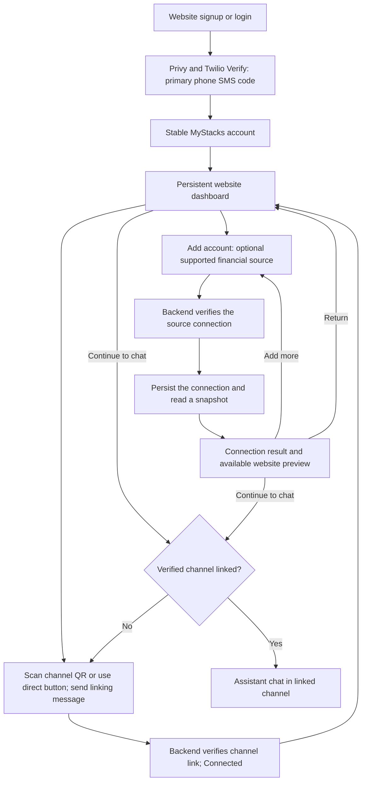

# Onboarding and account connection design

## 1. Status and scope

**Status: accepted Privy phone signup with Twilio Verify → persistent dashboard, financial connections and channel linking in either order, channel linking through QR codes or direct buttons, separate channel conversations with shared personal memory, verified EVM and Solana wallet connections, and website portfolio previews.** This document defines identity, messaging handoff, account connection, and access controls for the full Phase 1 experience. The provider baseline, Bird as the primary Apple Messages for Business MSP, and phone-authentication mapping below are accepted; remaining technical mappings and mechanisms are **TENTATIVE pending the overall architecture round**. Accepted product behavior and security boundaries remain requirements. Recovery policy, provider eligibility and coverage, and data-control policies remain open. Phone changes and recovery are low priority; account deletion is deferred.

The [onboarding stories](../user-stories/onboarding.md) own observable behavior. The [requirements](../requirements.md) own product scope, and the [architecture](../architecture.md) owns accepted runtime and security boundaries. Financial observations and connector reads belong to the [portfolio design](portfolio.md); conversation and memory belong to the [runtime design](runtime.md); ongoing work and delivery belong to the [task design](tasks.md).

Phase 1 provides financial information with read-only account access. Specific buy, sell, or rebalance recommendations and financial execution remain outside its authority. Onboarding establishes access to information without granting trading or money-movement authority.

The initial provider baseline is **SnapTrade** for Binance, Coinbase, Interactive Brokers (IBKR), moomoo, and Robinhood, **Zerion** for EVM and Solana wallets, and a **direct Hyperliquid connector at low priority**. The target includes mixed exchange and brokerage portfolios across regions; provider, region, and account eligibility determine what the dashboard may offer. Wallet-control verification is required before tracking. The EVM mechanism is defined below; the Solana mechanism and exact network, wallet, and portfolio coverage remain open. DeBank is an optional future complement for specific EVM coverage gaps; Bybit, Upbit, and prediction-market connectors are deferred. The [provider decision](../ADRS/0018-managed-financial-data-providers.md) owns this baseline and its limits.

## 2. Progressive connection flow

Website signup and channel linking precede assistant chat. The primary signup and login method is a phone number verified through Privy and Twilio Verify by an SMS code. Only phone verification is required for MyStacks signup; name, goals, and preferences are optional and learned through chat. Providers may have their own setup requirements. Financial connections are optional, so a signed-up user with a linked channel can ask general financial questions without connecting a source.

After successful phone verification, the user lands on the persistent website dashboard and can connect financial sources or link messaging channels in either order. The dashboard manages financial connections, messaging-channel links, proactive insights, and the immediate post-connection portfolio preview. Chat can change the same proactive insights setting. New and returning users use the same **Add account** flow: search supported sources, **Connect a wallet**, or **Skip for now**. Chat requests to add or manage connections link to this dashboard.

**Accepted flow and phone authentication:** the sequence, user choices, and Privy mapping below are accepted; remaining connection and channel handoff mechanics require joint architecture finalization.

These logical responsibilities may share a backend deployment. Signup, source authorization, and messaging verification are separate: completing one does not prove another. The website offers iMessage and WhatsApp QR codes and direct channel-link buttons on phone and desktop, with a copyable channel entry point and linking-message fallback. Displaying or scanning a QR code does not verify a channel. WhatsApp login is deferred; signup uses website phone verification. Preferences, supported channel-scoped work, and ongoing portfolio questions use chat. iMessage supports user-created schedules and proactive insights; WhatsApp supports user-initiated chat and one-off requested work, while schedules, proactive work and reports, and template messaging are deferred.

If a user messages before signup, the onboarding reply links to signup/sign-in in this same website flow. It does not grant assistant access. Interrupted or failed setup preserves completed connections and returns to the dashboard with an explanation and options to retry, choose another source, or continue to chat.

The website detects and saves the device timezone once during onboarding. Users explicitly change their personal default in the web app or chat; automatic re-detection on later visits is deferred. Task-specific timezone requests override only that task, while existing schedules keep their assigned zone unless edited. The [task design](tasks.md) owns timing confirmations, unknown-timezone clarification, and open recurrence/daylight-saving mechanics. The capture and persistence mapping remains tentative.

## 3. Identity, messaging, and financial authority

The [account identity decision](../ADRS/0014-stable-account-and-independent-channel-links.md) owns the rationale for a stable MyStacks account with separately verified login and channel bindings.

### 3.1 Separate bindings

**Accepted identity bindings:** Privy authenticates the website user, and the backend resolves the stable MyStacks account. Exact records and remaining provider mappings require architecture finalization.

| Binding | Purpose |
| --- | --- |
| MyStacks account | Stable internal account UUID, mapped from a unique `privy_user_id`, that owns connections, conversations, memory, preferences, and tasks. Mutable phone and channel bindings do not replace this account. Account ownership does not grant a chat access to another channel's history, jobs, tasks, or results. |
| Primary login phone | One verified phone per account, with one account per phone at a time. SMS-code signup and login establish phone control; account continuity must also respect reassigned phone numbers. |
| Messaging channel | A separately verified channel and sender bound to the authenticated MyStacks account. It determines which channel conversation can receive that account's information. |
| Financial connection | A source bound to that account, with its address or protected credential reference, supported coverage, and current access state. An EVM or Solana wallet requires wallet-control verification before it becomes a verified connection. |

The stable account preserves continuity when a phone number or channel changes. A new holder of a recycled phone number must not be treated as the original account owner. Phone-number changes, lost-number recovery, and email recovery are low priority; exact recovery evidence and reassignment policy remain open. The ordinary number-change flow verifies both the current and new phone. Privy owns identity, sessions, and access-token refresh; Twilio Verify handles SMS OTP delivery and checks through Privy. Login requires no embedded wallet.

On authenticated API requests, the backend verifies the Privy access JWT with the native SDK, including the expected app, issuer, signature, and expiry. It resolves the verified subject through the unique `privy_user_id`; the first authenticated request creates the internal account idempotently when absent, including concurrent requests. The account can be used without waiting for a webhook. Phone data comes from trusted, verified Privy identity data rather than request-body fields; the exact user-profile API or verified identity-token method remains open. Use dedicated project resources and configuration. The [account identity decision](../ADRS/0014-stable-account-and-independent-channel-links.md#23-privy-phone-authentication-and-account-creation) owns provider rationale, reference evidence, and production plan and country validation. [Privy access-token contract](https://docs.privy.io/authentication/user-authentication/access-tokens)

iMessage and WhatsApp are the launch channels, with iMessage taking priority. Each must be verified and linked separately, including when a provider exposes a sender phone matching the primary login phone. In this product, **iMessage** means Apple Messages for Business through Bird. Apple supplies an opaque customer identifier for the business, not the customer’s phone number or email; it cannot establish the MyStacks account binding by itself. SMS and additional future channels are bindings too. Exact provider identifier mappings remain open. Matching phone numbers or email addresses must not silently merge accounts or channel bindings. The [Apple messaging decision](../ADRS/0021-apple-messages-with-bird.md) owns the provider choice; the [Apple identity contract](https://register.apple.com/resources/messages/messaging-documentation/faq) defines the opaque identifier.

MyStacks authentication and attached-wallet proof are separate bindings. Signing the wallet-control message does not select a login provider, replace the authenticated MyStacks identity, or grant financial execution authority.

### 3.2 Connection and channel handoff

An account-connection link opens an authenticated companion-web flow. The backend binds the pending operation to the current user and browser session; a URL parameter or model-provided user identifier cannot establish authority. Link previews must not complete sign-in, attach an account, or consume an authorization action.

On phone and desktop, the signed-in website shows a QR code for each of iMessage and WhatsApp alongside **Open iMessage** and **Open WhatsApp**. Scanning a QR code or using a button opens a prepared linking message that the user sends; a copyable channel entry point and linking message provide a fallback. The website shows **Connected** only after separate verification succeeds. Displaying or scanning a QR code, or opening the messaging app, does not verify or link a channel. Only the website adds or disconnects messaging channels. The website and chat can change the same proactive insights setting.

**TENTATIVE channel handoff:** bind a short-lived, one-use linking challenge to the signed-in account and intended channel-link operation, then verify the challenge and inbound provider channel identity before linking it and reporting **Connected**. For Apple Messages for Business, this binds the opaque customer identifier to the authenticated account through the separate link verification. Matching a phone number is insufficient. Bird is the selected Apple adapter; exact challenge lifetime, provider identifier mappings, API/webhook integration, confirmation details, and polling or server-sent-event choices remain open.

When a provider uses OAuth or a hosted connection portal, use its supported SDK flow and validate callback state against the initiating session. Authorization codes are temporary inputs exchanged as the provider requires. OAuth client secrets, authorization-code exchange, and refresh handling stay in the trusted backend; the connection UI may receive temporary client-link tokens required by the selected SDK. Authorization codes and secrets must not be placed in chat, prompts, skills, job payloads, analytics, or traces. Section 4.5 governs credential brokering for authorized reads from an execution run. Financial adapters retain the credential boundary described in the [credential ADR](../ADRS/0002-backend-owned-financial-credentials.md).

### 3.3 Channel conversations and proactive delivery

iMessage and WhatsApp keep separate conversation history, current context, compaction, independent jobs, supported scheduled tasks, and results under the same MyStacks account. Chat accesses and controls only its own channel's supported work. iMessage supports user-created schedules. When asked to schedule work, WhatsApp explains that scheduling is unavailable there and directs the user to linked iMessage; it cannot create or manage iMessage tasks or retarget requested work. Financial connections, portfolio evidence, and durable personal facts, goals, and preferences are account-wide; useful personal facts learned in one channel may inform another, and corrections or forgetting apply across linked channels. Shared personal memory must not copy channel transcripts, task records, or results. The [runtime design](runtime.md) owns the tentative Mastra mapping and memory selection, conflict, deletion, and concurrent-write requirements.

**TENTATIVE access mapping:** trusted backend account and current-channel bindings constrain task/result access and agent capabilities. Protected handlers enforce both bindings rather than accepting a model-selected channel ID. A chat may explain other linked channels and change proactive insights without loading another channel's transcripts or task logs. Phase 1 has no scheduled-task destination selector, task transfer, or cross-channel history lookup. The runtime design owns the shared regular Agent and per-run context, without requiring a separate deployment for each channel.

Proactive insights are distinct from user-created scheduled tasks. **Proactive insights** is one account-wide setting shared by the website and chat. The website and supported chat controls enable or disable it for eligible linked iMessage only. It defaults to enabled, subject to applicable channel permissions. WhatsApp cannot be selected, and linking WhatsApp does not enable proactive work. Disabling the setting stops proactive investigations and unsent proactive delivery. Disconnecting iMessage removes the eligible destination without rerouting work to WhatsApp.

Each proactive investigation runs once account-wide only when enabled and an eligible linked iMessage destination is available. Each qualifying insight may be delivered there after current authorization, ownership, and channel-permission checks. Shared account context does not merge channel history, context, or tasks. Saved pending completions return through the normal channel handler under the [task design](tasks.md); automated replies and task reports wait during human ownership until explicit staff handback under the [human-support decision](../ADRS/0022-human-support-conversation-ownership.md). The task design also owns uncertain delivery: use provider-supported idempotency or status checks where available; if submission remains ambiguous, record uncertainty without blind automatic resend. Exact proactive context assembly, provider integration, and retries after definitive send failures remain tentative.

Scheduled tasks are created in iMessage and remain bound to that channel. Disconnecting that channel pauses its future scheduled runs and pending deliveries rather than rerouting them. History and tasks remain, and relinking the original channel does not auto-resume them; the user resumes from that channel. Already-started sends cannot be recalled. The [task design](tasks.md) owns active-attempt and one-off-job cancellation and outcome semantics.

## 4. Source setup and connector boundary

### 4.1 Source connection experiences

**Accepted provider baseline and connection boundaries:** SDK choices, detailed adapter mappings, and supported coverage require architecture finalization.

| Source | User action | Backend responsibility and limits |
| --- | --- | --- |
| EVM wallet — Zerion | Connect a supported wallet on the companion website, confirm the address and network, and sign a readable off-chain wallet-control message. | Complete EVM wallet-control verification before persisting a verified connection or starting portfolio reads and monitoring through Zerion. Native balance access does not establish token or DeFi coverage. |
| Solana wallet — Zerion; verification mechanism open | Connect a supported wallet on the companion website, confirm the address and network, and sign a readable off-chain wallet-control message. | Complete Solana wallet-control verification before persisting a verified connection or starting portfolio reads and monitoring through Zerion. The verification mechanism, SDK, and exact coverage remain open. |
| Hyperliquid — direct; low priority | Choose an eligible EVM wallet already verified in MyStacks, or connect another supported EVM wallet and sign a readable wallet-control challenge, then confirm the account information to include. | Reuse an eligible verified wallet without another signature. Bind the actual user account address to the active connection and read supported public Info endpoints by address. This read flow requires no user private key, OAuth, or trading key. Supported account relationships and modes require validation before they are offered. |
| Binance — SnapTrade | Create the user API key and secret required by SnapTrade's supported Binance connection flow, then return to the dashboard with connection status and coverage. | Enforce read-only permissions and supported coverage through SnapTrade, reject broader authority, and apply the credential boundary in section 4.5. Successful balance retrieval alone does not prove read-only permission. |
| Coinbase, Interactive Brokers (IBKR), moomoo, Robinhood — SnapTrade | Complete the institution-specific connection flow offered through SnapTrade and return to the dashboard with connection status and coverage. | Validate the supported authorization model, read-only access, region, account eligibility, and available evidence before offering the connection. Authorization steps and data readiness vary by institution. |

Source coverage depends on the provider and integration. Each source needs explicit account, region, network, and asset coverage before it is offered to a user; the baseline does not promise fixed spot, futures, vault, or subaccount coverage. EVM or Solana address entry alone cannot create a tracked connection. Provider integration and existing-code reuse require validation; a design reference does not establish that a connector is implemented. SnapTrade lists the target institutions in its [broker access guide](https://docs.snaptrade.com/docs/broker-access-guide), but [moomoo coverage is limited to US and Canadian accounts](https://support.snaptrade.com/Moomoo-e33feaa69a1c836f891381bb17911594), leaving the wider regional target unresolved.

SnapTrade's [Binance connection guide](https://support.snaptrade.com/Binance-de2feaa69a1c8362af15015d31eefd1f?pvs=21) requires an end-user API key and secret. Provider approval or KYB does not establish OAuth availability, a keyless connection, or a one-click experience. Other institutions use their own provider-supported authorization steps; exact eligibility, coverage, and read-only permissions require validation before the integration is offered.

The [Hyperliquid Info API](https://hyperliquid.gitbook.io/hyperliquid-docs/for-developers/api/info-endpoint) accepts public address-based queries and requires the actual master or subaccount address rather than an agent-wallet address. MyStacks still authorizes every portfolio read against the user's verified, active connection; arbitrary-address API access does not grant product connection or monitoring authority. Account-mode interpretation must follow Hyperliquid's [account abstraction documentation](https://hyperliquid.gitbook.io/hyperliquid-docs/trading/account-abstraction-modes) without promising support for every mode.

### 4.2 EVM wallet-control verification

Use [Sign-In with Ethereum (SIWE), ERC-4361](https://eips.ethereum.org/EIPS/eip-4361), for a readable off-chain proof that attaches a wallet to an already authenticated MyStacks user. The [wallet connection decision](../ADRS/0007-verified-evm-wallet-connections.md) owns the rationale. Reuse maintained SIWE and wallet SDK primitives for message construction, parsing, and signature verification; the SDK vendor remains open.

1. The companion website connects to a supported wallet and selects its address and chain. This establishes the proposed signer, not a verified EVM connection.
2. The backend issues a challenge with a cryptographically random, single-use, short-lived nonce. It binds the challenge to the authenticated MyStacks user, the initiating browser connection attempt, and the selected address. The backend records the expected domain, URI, chain ID, wallet-control purpose, issue time, and expiry.
3. The wallet presents the SIWE message for signing. Its readable statement explains that the purpose is to verify wallet control and attach a read-only connection; this flow grants no transaction or token-approval authority.
4. The backend validates the signature and the signed message against the issued challenge, including the expected address, domain, URI, chain ID, nonce, purpose, and time limits. It must also match the authenticated user and initiating browser connection attempt. A valid signature alone is insufficient.
5. After successful validation, the backend consumes the nonce once and persists the verified EVM connection. Completion must prevent reuse of the nonce, including concurrent submissions. Portfolio reads and monitoring start only after this succeeds.

For a supported externally owned account, verify the SIWE signature using [ERC-191](https://eips.ethereum.org/EIPS/eip-191). When smart contract wallets are supported, verify through [ERC-1271](https://eips.ethereum.org/EIPS/eip-1271) on the chain specified by the challenge. Supported wallet types and networks, and the cross-chain proof policy, remain open.

Cancelled, expired, invalid, mismatched, or already-used challenges must not complete the pending connection or trigger its portfolio reads and monitoring. These failures leave existing verified EVM connections unchanged. A retry requires a fresh challenge. The challenge TTL remains an implementation choice; challenge expiry does not expire a completed connection.

Every path that can create an EVM connection must use this backend verification boundary, including web, chat, tools, tasks, and imports. An address or uploaded evidence may support analysis within the applicable evidence rules, but cannot establish a verified EVM connection or start wallet tracking.

The verified EVM connection records proof of control at verification time. Routine reads and monitoring use its current connection state without daily signatures or an open wallet; EVM tracking itself has no periodic expiry. A new address or reattachment after disconnect requires fresh wallet-control verification.

### 4.3 Solana wallet-control verification

Solana wallet support must meet the same product boundary: a readable off-chain signature proves control before MyStacks persists a verified connection or starts portfolio reads and monitoring, and grants no transaction, token-approval, trading, or money-movement authority. MyStacks authentication remains separate from attached-wallet proof. An address, wallet connection, or uploaded evidence alone cannot establish verification.

Every Solana connection path, including web, chat, tools, tasks, and imports, must use the owning backend verification boundary. Cancelled, expired, invalid, or unsupported attempts create no verified connection and start no reads or monitoring; existing verified connections remain active. A new address or reattachment after disconnect requires fresh wallet-control verification. The Solana signing protocol, SDK, challenge validation, supported wallet types and networks, and exact Zerion portfolio coverage remain open for architecture design. The EVM SIWE and ERC mechanisms in section 4.2 apply only to EVM wallets.

### 4.4 Small shared connector contract

Each connector owns its setup validation and provider-specific permission checks. The portfolio design owns provider reads and their conversion into the shared financial evidence contract. The connection preview, chat, scheduled jobs, and proactive investigations use the same backend-authorized provider capabilities and financial evidence contract. Through **programmatic tool calling**, run code may compose supported SDK or provider API reads using credential brokering through an egress proxy, or a user-bound backend read API where provider authentication is incompatible with proxy injection. Provider integration, ownership checks, and evidence validation remain MyStacks responsibilities; each analysis does not need its own bespoke tool.

The minimum contract covers connection status, supported accounts and asset coverage, financial observations with native values and units, source and as-of information, and explicit gaps or errors. Setup remains provider-specific: wallet-control verification and an exchange credential do not need identical authentication flows. Schemas and method signatures belong to implementation design.

Adding a connector should require its setup experience and adapter, with any necessary capability exposure. It should reuse account binding, evidence presentation, task creation, scheduling, memory, and notification delivery. A connector marketplace or dynamic plugin loader would require a separate product need.

### 4.5 Provider credentials and persistence

**Provider-dependent contract:** SnapTrade, Zerion, and direct Hyperliquid reads keep their distinct authentication needs. The choice between **SnapTrade Commercial and Personal OAuth remains open**. Commercial `userId` and `userSecret` require application `consumerKey` HMAC signing; use a thin user-bound backend read API rather than exposing that signing authority to the sandbox. Personal OAuth can supply a per-user read access token without application-key signing, but changes the user and connection lifecycle to SnapTrade Personal; simpler proxy injection alone does not select it. A Personal API key is eligible only if its actual authority meets the required read-only scope. [SnapTrade authentication](https://docs.snaptrade.com/docs/authentication-methods), [OAuth model](https://docs.snaptrade.com/docs/oauth-apps)

All financial access is read-only and must remain bound to the authenticated user's active connections. **Raw provider credentials stay outside the E2B sandbox.** Use credential brokering through the native egress proxy to inject provider authentication outside the VM where supported. The backend controls the user credential, destination, permitted read operations, and account or object scope; read-only application authority cannot expose other users' private data. When proxy injection cannot support the provider's authentication, the user-bound backend read API enforces the same checks without arbitrary signing or unrestricted forwarding. A narrow run authorization or opaque placeholder may be present in code; its exact mechanism remains open. Application-wide authority, database credentials, model keys, E2B management keys, OAuth client secrets, and refresh handling remain backend-owned.

The exact saved fields, expiry, renewal, rotation, revocation, and reconnect behavior follow each provider's documented contract; a universal access-token and refresh-token schema is not assumed. Direct Hyperliquid public reads need no user credential. Webshare proxy authentication remains a backend secret, and the [provider decision](../ADRS/0018-managed-financial-data-providers.md) owns its transport limits.

The [credential ADR](../ADRS/0002-backend-owned-financial-credentials.md) selects **GCP Secret Manager for application-wide credentials** and **per-user provider credentials encrypted in PostgreSQL using GCP KMS**. Trusted API and worker processes resolve permitted credentials and configure brokered access only after account and connection authorization. The selected vendor's external secret store or proxy may handle raw provider credentials outside the sandbox VM. Keep raw credentials out of sandbox code and files, prompts, skills, intentional persistent model memory, traces, and job payloads. Sandbox code receives the user's authorized data and may disclose it; that exposure is an accepted necessary trade-off for analysis. Access to another user's private data or keys remains forbidden.

Provider API access uses default-deny sandbox networking with backend-controlled required-provider egress through credential brokering or the user-bound read API; analysis with no outbound need may remain offline. General public-web research uses separate backend tools. Required SDK guidance may live in skills, but permissions are enforced outside prompts and skills. A separate financial access service remains deferred. Exact schemas, IAM, key granularity, rotation, supported encryption and proxy integration, and run-bound API authentication remain open. The [provider integration TODOs](../TODO.md#3-financial-provider-integration) track those choices.

## 5. First synchronization and portfolio evidence

After successful source setup, the backend persists the authorized connection and starts its first read. For EVM and Solana wallets, successful wallet-control verification is required before either action. Connection authorization and data readiness are distinct: an attached account may still be syncing, partially available, or in need of repair. Required progress survives the browser session.

The immediate website preview and agent analyses use the same authorized financial evidence contract, including direct provider reads where supported. After each connection, the dashboard shows its result and available value, holdings, positions, and included accounts without waiting for every source, with **Add more** and **Continue to chat**. If no messaging channel is linked, **Continue to chat** prompts channel linking before assistant access. Portfolio answers in chat follow user requests. An unconnected or unavailable source displays a clear empty or unavailable state, not a zero balance. One successful source can produce a useful partial snapshot while another is unavailable.

Before presenting current portfolio information, fetch the latest relevant holdings and prices available from the provider; brief reuse is allowed when the evidence remains suitable. Show source observation times, delays, and coverage gaps. Fresh prices applied to old holdings do not establish a current portfolio. The [current evidence decision](../ADRS/0019-current-portfolio-evidence.md) owns this rule; exact maximum ages remain open. SnapTrade's [freshness options](https://docs.snaptrade.com/docs/realtime-data) remain subject to institution limits: its [IBKR data is daily and delayed](https://support.snaptrade.com/Interactive-Brokers-f62feaa69a1c822ebb0e01a28b2f195a?pvs=21), so IBKR remains an unresolved target for current portfolio evidence. The preview must describe delayed available data honestly rather than imply that a completed connection makes it current.

The current portfolio uses supported provider data. USD is the default display value while native asset quantities remain intact. Portfolio-value changes are distinct from investment gains or losses, with deposits and withdrawals separated when evidence supports it. Changes calculated by MyStacks require adequate comparison evidence; a first snapshot alone cannot establish a 24-hour gain or loss. Suitable provider-calculated historical metrics may be reused with their meaning, period, coverage, and observation time, without reconstructing the underlying history. A MyStacks indexer and historical reconstruction or P&L requiring MyStacks infrastructure are deferred at low priority. The [portfolio design](portfolio.md) owns common calculation definitions and the use of supported provider data. Exact formulas, cost basis, valuation sources, and supported metrics remain open and provider-dependent.

Mastra receives only authorized evidence and user context. Provider reads remain within the backend-authorized scope and retain their source, as-of, coverage, and freshness limits. Personal memory may retain goals or preferences, but it cannot replace current balances, prices, or authorization.

## 6. Account lifecycle and data controls

### 6.1 Connection removal and incomplete work

Only the website dashboard can remove a financial connection; chat explains the action and links to the dashboard. Disconnecting stops future reads through that connection and excludes the source from the current portfolio while other sources continue. New jobs and protected reads respect current connection state. Affected tasks continue only when remaining authorized evidence fulfills their request; otherwise pause them and explain why once in their originating channel. Restoring the source leaves them paused until the user resumes them from that channel at the next scheduled time without a backlog. Temporary provider outages follow failure recovery rather than explicit-disconnection behavior. The [task design](tasks.md) owns the tentative enforcement mechanism. Past reports remain under the separate retention policy. Provider revocation depends on the integration; a directly created exchange key may also need removal in the provider's own settings.

Supported renewal without user action is automatic. Request reconnect only when the provider requires user action; temporary outages mark the source unavailable rather than implying expired authorization. Exact provider renewal and retry mechanisms remain tentative.

For an EVM or Solana wallet, disconnecting ends the connection used for reads and monitoring. Reconnecting that wallet requires fresh wallet-control verification. An expired sign-in session requires MyStacks reauthentication, while an expired wallet challenge only ends that incomplete verification attempt.

Disconnecting, deleting imported data, and deleting the MyStacks account are separate operations. Their retention and deletion policies remain open, and account deletion is deferred. Onboarding interruption preserves completed connections and returns to the same dashboard so the user can retry, choose another source, or continue to chat without reconnecting successful sources.

### 6.2 Returning users and recovery

After successful authentication, returning users resume the same MyStacks account and its dashboard, using the same **Add account** flow as new users. Session expiry requires reauthentication; it does not create a replacement portfolio. The low-priority ordinary phone-number change flow verifies the current and new numbers, updates the primary-phone binding, and preserves the stable account ID, financial connections, channel conversations, shared personal memory, preferences, tasks, results, and separately linked messaging channels. Recovery and changes to login or messaging identities must preserve the established account binding and require evidence appropriate to the sensitive data being exposed. Lost-number and email recovery are low priority, with exact evidence and policy open.

Only website settings add or disconnect messaging channels. The website and chat change the same proactive insights setting, and notification destinations must use confirmed channel bindings. Scheduled tasks keep their originating channel and pause on its disconnect; proactive insights use the account setting and eligible linked iMessage destination in section 3.3. The [task design](tasks.md) owns task delivery, pending-completion recovery, cancellation, and uncertain-send behavior; exact provider integration remains tentative. Access from another user's browser, conversation, or connection identifier, or another channel's task/result identifiers, must be rejected at the owning backend boundary.

### 6.3 Export and deletion proposals

User-facing data review and export remain proposed capabilities whose exact scope and retention policy need agreement. Account deletion is deferred. Any offered data control must distinguish stopping source access, deleting stored evidence, removing saved personal profile entries, removing reports, and closing the account. The runtime design owns [profile-only forgetting](../ADRS/0011-profile-only-forgetting.md), which leaves conversation histories and compact summaries unchanged; the task design owns suppression of future work and notifications.

The product must state what an operation covers and report its outcome accurately. It must not claim deletion from a financial provider, messaging history, backups, or legally retained records unless the applicable contract supports that claim. Exact retained records, recovery windows, and deletion timing remain open.

## 7. Open decisions

- **Source coverage:** supported EVM and Solana wallet networks and types, EVM cross-chain proof policy, and provider-supported regions, accounts, assets, and positions. The SnapTrade and Zerion baseline is accepted; moomoo coverage beyond US/Canada and current IBKR evidence remain unresolved targets.
- **Wallet implementation:** maintained SIWE and wallet SDK choice and short-lived challenge TTL for EVM; signing protocol, SDK, and challenge validation for Solana.
- **Hyperliquid connection:** supported account relationships and modes, coverage, and detailed transport settings. Website reuse of an eligible verified EVM wallet or a new control challenge, binding the actual user account address, and public reads without user credentials are accepted; direct Hyperliquid remains low priority.
- **Identity and recovery:** native Privy SDK integration, trusted verified-phone retrieval, production plan and country eligibility, and exact recovery evidence and reassignment policy. Phone-number changes, lost-number recovery, and email recovery are low priority; ordinary number changes verify the current and new phones.
- **Channel linking:** short-lived one-use challenge lifetime, provider identifier mappings, confirmation mechanics, and polling or server-sent-event updates within the separate account and channel verification boundary. Bird is the selected Apple adapter; its exact product/API version and webhook configuration remain open. QR codes, direct buttons, and the copyable fallback are accepted; verification remains separate from the QR display or scan.
- **Proactive delivery:** context assembly and provider integration within the accepted account setting, eligible linked iMessage destination, pending-completion recovery, and uncertain-send rules. Retries after definitive send failures remain open. Scheduled tasks remain channel-bound; their lifecycle belongs to the task design.
- **Apple messaging controls:** Bird is the primary MSP for our own Apple Messages for Business account, with Photon retained as a backup integration plan. Account approval, experience review, the exact permitted financial notification scope, required notices and opt-outs, and provider configuration remain validation items under the [Apple messaging decision](../ADRS/0021-apple-messages-with-bird.md). Business verification alone does not grant direct Apple API access.
- **Provider integration:** the detailed provider connection and credential contracts in section 4.5 remain open within the accepted credential storage, credential brokering, user-bound backend reads, and run isolation boundaries. First-read progress also remains open. Only provider-required user action prompts reconnect; EVM challenge expiry does not expire completed tracking.
- **Data controls:** account review and export scope, retained records, and completion reporting across storage owners and providers. Account deletion is deferred.

The overall architecture round must jointly finalize the tentative mappings and flow mechanics. These decisions refine the complete onboarding and account lifecycle. Observable acceptance belongs to the companion user stories.
