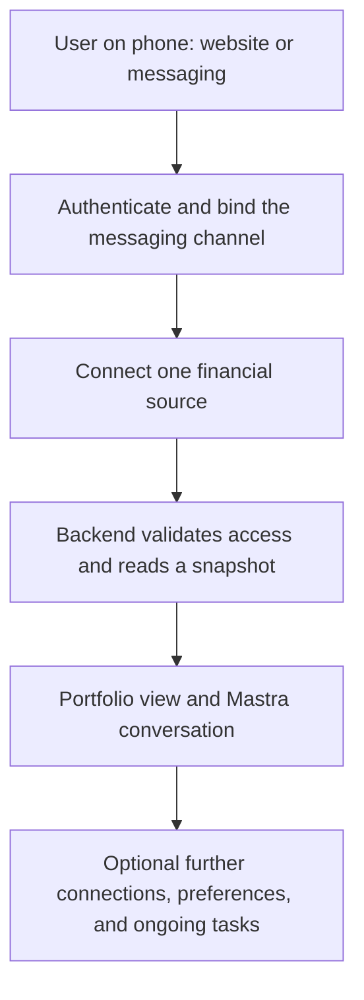

# Onboarding and account connection design

## 1. Status and scope

**Status: proposed detailed design.** Progressive onboarding is accepted. This document defines identity, messaging handoff, account connection, and access controls for the full Phase 1 experience. Detailed login, provider integration, recovery, and data-control policies remain open.

The [onboarding stories](../user-stories/onboarding.md) own observable behavior. The [requirements](../requirements.md) own product scope, and the [architecture](../architecture.md) owns accepted runtime and security boundaries. Financial observations and connector reads belong to the [portfolio design](portfolio.md); conversation and memory belong to the [runtime design](runtime.md); ongoing work and delivery belong to the [task design](tasks.md).

Phase 1 provides financial information with read-only account access. Specific buy, sell, or rebalance recommendations and financial execution remain outside its authority. Onboarding establishes access to information without granting trading or money-movement authority.

## 2. Progressive connection flow

These are logical responsibilities and may share a backend deployment. Website entry and messaging entry converge on the same account and connection flow. A phone can open the companion website or provider app and return to the conversation; desktop QR codes are an optional handoff from another screen.

## 3. Identity, messaging, and financial authority

### 3.1 Separate bindings

| Binding | Purpose |
| --- | --- |
| MyStacks user identity | Stable account identity established by the chosen authentication system. A phone number is a changeable login or contact attribute, not the permanent account identifier. |
| Messaging channel | A verified channel and sender bound to the authenticated user. It determines which conversation can receive that user's information. |
| Financial connection | A source bound to that user, with its address or protected credential reference, supported coverage, and current access state. |

Reuse an authentication provider or an existing compatible integration. Phone OTP, passkeys, email, and other login options remain candidates. The authentication design must address returning users, recovery, and changed or reassigned phone numbers before exposing connected financial data.

### 3.2 Connection and channel handoff

An account-connection link opens an authenticated companion-web flow. The backend binds the pending operation to the current user and browser session; a URL parameter or model-provided user identifier cannot establish authority. Link previews must not complete sign-in, attach an account, or consume an authorization action.

When channel linking is needed, the user proves control of the channel and confirms the destination being attached to the authenticated account. Use a short-lived, single-use challenge bound to that operation. Matching phone numbers alone must not merge accounts or expose an existing user's financial information. Exact challenge transport and expiration remain implementation choices.

When a provider uses OAuth or a hosted connection portal, use its supported SDK flow and validate callback state against the initiating session. Credentials and authorization codes must stay out of chat, model context, E2B, analytics, and traces. Financial adapters retain the credential boundary described in the [credential ADR](../ADRS/0002-backend-owned-financial-credentials.md).

## 4. Source setup and connector boundary

### 4.1 Candidate connection experiences

| Source | User action | Backend responsibility and limits |
| --- | --- | --- |
| Public wallet | Enter an address and supported network; optionally label it. | Validate the address and read supported public holdings. This creates a tracked address, not proof of wallet ownership. Native balance access does not establish token or DeFi coverage. |
| Hyperliquid | Enter the actual account address and select supported accounts where applicable. | Query public account information. Agent-wallet addresses are signing identities and may return empty results; subaccounts, vault equity, and account modes need explicit coverage. |
| Binance | Follow instructions to create a dedicated read-only key, then enter its key and secret in the secure connection form. | Validate permissions through the provider, reject broader authority, and store secrets in the backend credential boundary. Successful balance retrieval alone does not prove read-only permission. |

Each source needs explicit account, network, and asset coverage before it is offered to a user. A public address can provide a low-friction starting point for a user who holds supported assets there. Provider integration and existing-code reuse require validation; a design reference does not establish that a connector is implemented.

Binance documents API-key creation through its app. Its OAuth and Fast API routes have partner requirements, so a keyless connection is not a launch assumption. SnapTrade offers a mobile-compatible portal, but its documented Binance flow still requires API credentials and currently describes Spot coverage without subaccounts. A hosted portal and the underlying provider permissions must be assessed separately. [Binance key setup](https://www.binance.com/en/support/faq/detail/360002502072), [Binance OAuth](https://developers.binance.com/en/docs/products/login/introduction), [SnapTrade portal](https://docs.snaptrade.com/docs/implement-connection-portal), [SnapTrade Binance coverage](https://support.snaptrade.com/Binance-de2feaa69a1c8362af15015d31eefd1f?pvs=21)

Public reads and account addressing are documented in [Ethereum JSON-RPC](https://ethereum.org/developers/docs/apis/json-rpc/#eth_getbalance) and the [Hyperliquid Info API](https://hyperliquid.gitbook.io/hyperliquid-docs/for-developers/api/info-endpoint). These capabilities do not imply complete portfolio coverage.

### 4.2 Small shared connector contract

Each connector owns its setup validation and provider-specific permission checks. The portfolio design owns provider reads and their conversion into the shared financial evidence contract. Website views, agent tools, and scheduled jobs consume that contract instead of containing separate provider-specific financial logic.

The minimum contract covers connection status, supported accounts and asset coverage, financial observations with native values and units, source and as-of information, and explicit gaps or errors. Setup remains provider-specific: a public address and an exchange credential do not need identical authentication flows. Schemas and method signatures belong to implementation design.

Adding a connector should require its setup experience and adapter, with any necessary capability exposure. It should reuse account binding, evidence presentation, task creation, scheduling, memory, and notification delivery. A connector marketplace or dynamic plugin loader would require a separate product need.

## 5. First synchronization and portfolio evidence

The backend persists the authorized connection and starts its first read. Connection authorization and data readiness are distinct: an attached account may still be syncing, partially available, or in need of repair. Required progress survives the browser session.

The portfolio view and Mastra tools read the same backend evidence. An unconnected or unavailable source displays a clear empty or unavailable state, not a zero balance. One successful source can produce a useful partial snapshot while another is unavailable. Historical changes require an adequate baseline; a first snapshot alone cannot establish a 24-hour gain or loss.

Mastra receives only authorized evidence and user context. The backend owns source permissions and current financial truth. Personalization memory may retain goals or preferences, but it cannot replace current balances, prices, or authorization.

## 6. Account lifecycle and data controls

### 6.1 Connection removal and incomplete work

Disconnecting a source stops future reads through that connection. New jobs and protected reads must respect current connection state. Affected tasks must explain the missing source or request repair rather than quietly substitute zero. Provider revocation depends on the integration; a directly created exchange key may also need removal in the provider's own settings.

Disconnecting, deleting imported data, and deleting the MyStacks account are separate operations. Their retention and deletion policies remain open. Onboarding interruption must preserve completed steps so the user can return without reconnecting successful sources.

### 6.2 Returning users and recovery

After successful authentication, returning users resume the same account, connections, preferences, and tasks. Session expiry requires reauthentication; it does not create a replacement portfolio. Recovery and changes to login or messaging identities must preserve the established user binding and require evidence appropriate to the sensitive data being exposed.

Changing a notification destination requires confirmation of the new channel binding. The task design defines how that change affects queued deliveries. Access from another user's browser, conversation, or connection identifier must be rejected at the owning backend boundary.

### 6.3 Export and deletion proposals

User-facing data review, export, and account-deletion controls are proposed capabilities whose exact scope and retention policy need agreement. The backend must distinguish stopping source access, deleting stored evidence, forgetting derived memory, removing reports, and closing the account. The runtime design owns cleanup of enabled memory layers; the task design owns suppression of future work and notifications.

The product must state what an operation covers and report its outcome accurately. It must not claim deletion from a financial provider, messaging history, backups, or legally retained records unless the applicable contract supports that claim. Exact retained records, recovery windows, and deletion timing remain open.

## 7. Open decisions

- **Source coverage:** supported networks, providers, account types, and assets for wallet, Binance, and Hyperliquid connections.
- **Identity and delivery:** authentication method, recovery policy, launch messaging channel, and channel-linking flow.
- **Connection lifecycle:** setup validity, provider permission checks, authorization expiry, reconnect behavior, revocation, and first-read progress.
- **Data controls:** account review, export, deletion, retained records, and completion reporting across storage owners and providers.

These decisions refine the complete onboarding and account lifecycle. Observable acceptance belongs to the companion user stories.
